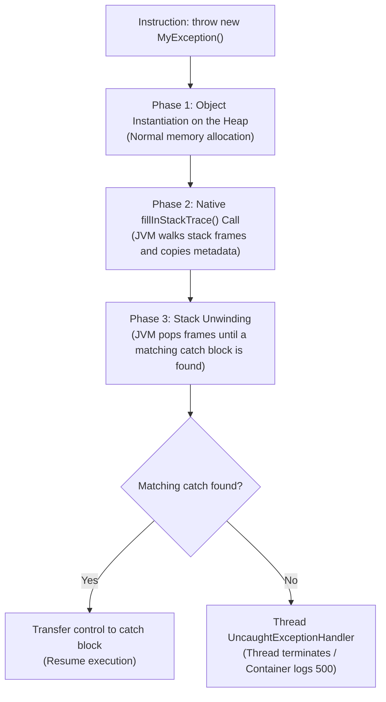

# Java & Spring Exception Foundations: JVM Stack Frames, Checked Exception Traps & Domain Hierarchy

In our exploration of [Response Handling & Status Codes](/notes/spring-boot-response-handling-responseentity-status-codes-custom-envelopes), we examined how production microservices structure their egress contracts: communicating success via `200 OK`, `201 Created`, or `204 No Content`.

However, in any distributed enterprise system, things inevitably break:
- A user requests a bank transfer exceeding their account balance.
- A database unique constraint is violated during concurrent registrations.
- An upstream third-party payment gateway drops its TCP connection mid-handshake.
- A database driver fails to acquire a connection from the HikariCP pool.

Before jumping into Spring's web-tier annotations—such as `@RestControllerAdvice` or RFC 7807 `ProblemDetail`—we must first confront a deeper, architectural question:

> *"What actually happens inside the Java Virtual Machine when an exception is thrown? Why did the Java creators introduce checked exceptions in 1995, why did the Spring Framework completely abandon them, and how should an enterprise backend architect design business exceptions that do not pollute core domain logic?"*

---

## 01. The Problem Space: Why Exceptions Exist

### The Ancient World of C-Style Return Codes

Before object-oriented exception models, programming languages (such as C) communicated errors through **return codes** or global flags (like `errno`):

```c
// C-Style Error Handling: Mixing data and error signals
int status = withdraw_funds(account_id, 500);
if (status == -1) {
    // Insufficient funds
} else if (status == -2) {
    // Database connection timeout
} else if (status == -3) {
    // Account frozen
}
```

This model suffered from fatal architectural flaws in large-scale software engineering:
1. **The "Ignored Return Code" Bug**: Callers frequently forgot to check `if (status == -1)`. The program continued executing in an invalid state, leading to silent data corruption thousands of instructions later.
2. **Polluted Signatures**: A method could not easily return both a computation result (e.g., `User` or `BigDecimal`) and an error code without awkward pointer mutations or wrapper structs.
3. **Loss of Context**: An integer `-1` tells you *what* failed, but gives zero information about *where* it failed, what parameters were passed, or what the call stack looked like at the moment of failure.

### The Object-Oriented Exception Model

Java was designed to solve this by making errors **first-class objects** that separate normal execution from error recovery:
- **Non-Ignorable**: If an exception is not explicitly handled, the JVM automatically unwinds the call stack and terminates the thread, preventing silent corruption.
- **Rich Context**: An exception object lives on the heap, carrying an error message, arbitrary domain metadata, cause chains, and a full snapshot of the execution stack.
- **Separation of Concerns**: Business logic runs cleanly inside a `try` block, while failure policies are consolidated in `catch` blocks or centralized advisories.

---

## 02. First Principles: What Happens in the JVM When an Exception Is Thrown?

### The Call Stack & Activation Records (Stack Frames)

To understand exceptions, we must visualize the **JVM Thread Call Stack**. 

Every thread in a Java application (such as a Tomcat worker thread `http-nio-8080-exec-1`) possesses its own private JVM stack. Every time a method is invoked, the JVM pushes an **Activation Record (Stack Frame)** onto that stack. A stack frame holds:
- Local variable arrays.
- Operand stack.
- Reference to the runtime constant pool of the executing class.
- The **Program Counter (PC) Register** tracking the current bytecode instruction.

```
+-----------------------------------------------------------+
|               JVM Thread Call Stack (Egress Journey)       |
+-----------------------------------------------------------+
| [Frame 4]: OrderRepository.save()      Line 88  (TOP)     | <-- Exception occurs here!
| [Frame 3]: OrderService.createOrder()  Line 42            |
| [Frame 2]: OrderController.create()    Line 25            |
| [Frame 1]: DispatcherServlet.doDispatch() Line 1050 (BASE)|
+-----------------------------------------------------------+
```

---

### The Three Phases of an Exception Event

When code executes `throw new InsufficientFundsException("Balance too low")`, the JVM performs three distinct operations:



#### Phase 1: Heap Allocation
The exception is a standard Java object. `new InsufficientFundsException()` allocates memory in the Young Generation (Eden space) of the JVM Heap.

#### Phase 2: The Native Stack Walk (`fillInStackTrace()`)
The constructor of `java.lang.Throwable` invokes a native method:

```java
public synchronized Throwable fillInStackTrace() { ... }
```

This is the most critical and expensive step. The JVM pauses execution of the thread, transitions into C++ native runtime code, and walks backwards through the thread's stack frames. It inspects every active frame from the top of the stack down to the thread's entry point (`main()` or `Thread.run()`), extracting:
- The declaring class name.
- The method name.
- The source file name.
- The exact line number corresponding to the Program Counter (PC).

It stores this snapshot inside a private array of `StackTraceElement[]` on the exception instance.

#### Phase 3: Stack Unwinding
The JVM now abandons normal linear execution. It looks at the current method's bytecode **Exception Table**. 

- If the current method contains a `try-catch` block whose type matches the thrown exception, execution branches immediately to the `catch` bytecode offset.
- If no matching handler exists in the current frame, the JVM **unwinds** (destroys) the frame, pops it off the stack, and returns to the calling method's frame. It repeats this search up the call tree.
- If the exception unwinds all the way to the base of the thread without being caught, the JVM invokes the thread's `UncaughtExceptionHandler`, prints the stack trace, and destroys the thread. In a web application, Spring Boot's container catches this at the `DispatcherServlet` boundary to prevent thread destruction.

---

### The Hidden Performance Cost of Exceptions

A common question asked by senior backend engineers is:

> *"Why do performance profiling guides strictly warn: 'Never use exceptions for normal control flow'?"*

The answer lies in **`fillInStackTrace()`**.

Creating a regular Java object takes **nanoseconds**. But walking a stack of 40 to 60 frames (typical for a Spring Boot microservice with proxies, security filters, interceptors, and transactions) requires **microseconds**. 

Under high concurrency (e.g., 20,000 requests per second):
- If you use exceptions to check business validation (e.g., throwing `InvalidZipCodeException` whenever a user inputs an invalid zip code), the CPU spends up to **30% of its total cycles** walking stack frames in C++ rather than executing business logic.
- Furthermore, generating thousands of stack traces per second generates significant short-lived heap allocations, triggering frequent Minor Garbage Collection pauses.

```
+-----------------------------------------------------------------------------------+
|                     Operation Latency Comparison (JVM Microbenchmark)             |
+-----------------------------------------------------------------------------------+
| Normal Method Return (boolean / Result<T>) : ~1.2 nanoseconds                     |
| Instantiating Plain Java Record / POJO     : ~4.5 nanoseconds                     |
| Instantiating Exception WITHOUT StackTrace : ~7.8 nanoseconds                     |
| Throwing Exception WITH fillInStackTrace() : ~1,850 - 4,200 nanoseconds (~300x!) |
+-----------------------------------------------------------------------------------+
```

#### High-Throughput Optimization: The Fast Exception
When designing high-throughput, low-latency microservices where an exception is caught immediately by a framework advisory and its stack trace is never printed (e.g., a simple business validation signal), you can disable stack trace generation:

```java
public class FastValidationException extends RuntimeException {
    public FastValidationException(String message) {
        super(message, null, false, false); // writableStackTrace = false
    }

    @Override
    public synchronized Throwable fillInStackTrace() {
        return this; // Bypasses the native JVM stack walk entirely!
    }
}
```

By passing `writableStackTrace = false` or returning `this` from `fillInStackTrace()`, the exception instantiates in nanoseconds, eliminating 99% of the CPU overhead.

---

## 03. The `Throwable` Architectural Hierarchy

Every error condition in Java is an instance of `java.lang.Throwable`. The hierarchy divides strictly into two distinct branches:

```
                                java.lang.Throwable
                                         |
               +-------------------------+-------------------------+
               |                                                   |
        java.lang.Error                                  java.lang.Exception
  (Unrecoverable JVM Failures)                     (Recoverable Application Conditions)
  - OutOfMemoryError                                               |
  - StackOverflowError                     +-----------------------+-----------------------+
  - VirtualMachineError                    |                                               |
                                    Checked Exceptions                           RuntimeException
                            (Compiler Enforced / Explicit throws)        (Unchecked / Programming Errors)
                            - IOException                                - NullPointerException
                            - SQLException                               - IllegalArgumentException
                            - ClassNotFoundException                     - DataAccessException (Spring)
                                                                         - DomainException (Custom)
```

---

### Branch 1: `java.lang.Error` (Fatal JVM Disasters)

`Error` represents fatal, catastrophic system conditions from which an application **cannot** reasonably be expected to recover:
- **`OutOfMemoryError`**: The JVM has exhausted physical or configured heap space and Garbage Collection cannot reclaim memory.
- **`StackOverflowError`**: Infinite recursion has consumed the thread's stack memory.
- **`LinkageError` / `NoClassDefFoundError`**: Incompatible JAR versions or missing class definitions at runtime.

#### The Golden Rule: Never Catch `Error`
```java
// CATASTROPHIC ANTI-PATTERN: Never catch Throwable or Error
try {
    processOrder();
} catch (Throwable t) { // Catches OutOfMemoryError!
    logger.error("Something failed, continuing...");
}
```

If you catch `OutOfMemoryError`, the JVM's internal state is compromised. Objects may be half-initialized, locks may be held indefinitely, and background threads may have died silently. An application should allow `Error` to crash the process so orchestrators (like Kubernetes or Docker) can immediately restart a fresh, healthy container replica.

---

### Branch 2: `java.lang.Exception` (The Fork in the Road)

`Exception` represents conditions that a reasonable application might want to catch and handle. It splits into two fundamentally opposed camps:

#### 1. Checked Exceptions (Subclasses of `Exception` that do not extend `RuntimeException`)
- **Examples**: `IOException`, `SQLException`, `ClassNotFoundException`, `ParseException`.
- **Compiler Rule**: The Java compiler strictly enforces that any code calling a method that declares a checked exception **must** either handle it via `try-catch` or declare it in its own signature via `throws`.

#### 2. Unchecked Exceptions (Subclasses of `RuntimeException`)
- **Examples**: `NullPointerException`, `IllegalArgumentException`, `IllegalStateException`, `IndexOutOfBoundsException`.
- **Compiler Rule**: The compiler does not verify whether they are caught or declared. They propagate up the stack freely until caught or until they reach the top-level error handler.

---

## 04. The Great Architectural Debate: Why Spring Abandoned Checked Exceptions

In 1995, Java's creators believed that **Checked Exceptions** were a revolutionary breakthrough in software reliability:
> *"If we force developers at compile-time to handle every potential failure (such as network drops or file missing), software will never crash in production!"*

Thirty years later, the consensus among modern software architects is that checked exceptions were **one of the greatest design mistakes in language history**.

Modern languages (such as Kotlin, C#, Rust, Go, TypeScript, and Swift) completely omitted checked exceptions. Even within the Java ecosystem, modern frameworks—led by **Spring Framework**—strictly operate on unchecked exceptions.

Here is the architectural breakdown of why checked exceptions failed in enterprise applications:

---

### Flaw 1: The Leaky Abstraction Trap

Consider a clean hexagonal or layered architecture where a domain service talks to a repository interface:

```java
// ANTI-PATTERN: Leaking SQL details into the core domain
public interface UserRepository {
    User findById(UUID id) throws SQLException; // LEAK!
}
```

If `UserRepository` declares `throws SQLException`:
1. Your core business domain is now permanently coupled to relational SQL databases.
2. If your team migrates that entity to MongoDB, Redis, or an external gRPC service, you cannot change the implementation to `throws MongoException` without breaking every single service, controller, and test in the entire codebase!
3. To avoid this, developers were forced to create useless generic wrapper exceptions at every architectural boundary.

---

### Flaw 2: The "Empty Catch" Anti-Pattern (Swallowing Errors)

When developers are forced by the compiler to handle exceptions they cannot logically recover from, human nature takes the path of least resistance:

```java
// THE DEADLY SWALLOW: Silently hides bugs from production logs
try {
    accountService.debit(amount);
} catch (PaymentGatewayException e) {
    // Left empty or just e.printStackTrace() because the developer 
    // was in a hurry and "this should never happen"
}
```

Because the compiler insisted on a `catch` block, the developer swallowed the error. In production, transactions failed silently, account balances fell out of sync, and engineering teams spent weeks hunting "ghost bugs" with zero log evidence.

---

### Flaw 3: Breaking Modern Functional Java (Streams & Lambdas)

With the arrival of Java 8, checked exceptions became catastrophic. None of Java's standard functional interfaces (`Function<T, R>`, `Predicate<T>`, `Consumer<T>`, `Supplier<T>`) declare checked exceptions:

```java
List<String> userIds = List.of("1", "2", "3");

// THIS DOES NOT COMPILE!
List<User> users = userIds.stream()
    .map(id -> userService.loadUser(id)) // Error: unhandled IOException
    .toList();
```

Because `loadUser()` declares `throws IOException`, you cannot use it inside a standard `.map()` stream without wrapping it in an ugly, verbose `try-catch` block inside the lambda:

```java
// UGLY BOILERPLATE: Ruins readability
List<User> users = userIds.stream()
    .map(id -> {
        try {
            return userService.loadUser(id);
        } catch (IOException e) {
            throw new UncheckedIOException(e);
        }
    })
    .toList();
```

---

### How Spring Revolutionized Enterprise Java: Exception Translation

When Rod Johnson created the Spring Framework, he established the **Exception Translation Pattern**.

Spring took hundreds of archaic, vendor-specific checked exceptions from JDBC (`java.sql.SQLException`) and wrapped them into a rich, **unchecked** hierarchy rooted at:

```
org.springframework.dao.DataAccessException (extends RuntimeException)
```

```
                             DataAccessException (Unchecked)
                                            |
         +----------------------------------+----------------------------------+
         |                                  |                                  |
CannotAcquireLockException        DuplicateKeyException           DataIntegrityViolationException
(Deadlock / Timeout)              (Unique index collision)        (Foreign key / Not-null failure)
```

#### Why This Changed Backend Engineering Forever:
1. **Decoupled Business Logic**: Your service methods no longer need `throws SQLException`. They focus purely on business logic.
2. **Transparent Propagation**: If the database connection drops, the unchecked `CannotCreateTransactionException` bubbles seamlessly through your repositories and services, all the way to a centralized `@RestControllerAdvice`, without touching intermediate business signatures.
3. **Semantic Granularity**: Instead of inspecting obscure SQL error codes (e.g., Oracle error code `ORA-00001` vs. PostgreSQL code `23505`), Spring inspects the SQL state and translates it into standard Spring exceptions like `DuplicateKeyException`.

---

## 05. Domain-Driven Exception Modeling: Building Enterprise Hierarchies

A major defect in junior backend code is throwing generic exceptions:

```java
// AMATEUR ANTI-PATTERN: Generic, untyped runtime exceptions
if (user == null) {
    throw new RuntimeException("User not found"); // Bad!
}
if (balance.compareTo(amount) < 0) {
    throw new IllegalArgumentException("Insufficient balance"); // Bad!
}
```

### Why Generic Exceptions Fail in Production:
1. **No Semantic Type Safety**: An `@RestControllerAdvice` cannot distinguish whether an `IllegalArgumentException` came from your deliberate business rule or from a bug inside a third-party JSON parser.
2. **Missing Structured Metadata**: A client or log parser cannot read the user's ID, the attempted transaction amount, or the currency code without parsing fragile free-text strings.
3. **Fragile Client Contracts**: You cannot reliably map generic exceptions to deterministic HTTP status codes (`404 Not Found` vs. `422 Unprocessable Content`).

---

### Designing an Enterprise Domain Exception Hierarchy

In Domain-Driven Design (DDD), exceptions are **domain concepts**. They represent explicit business invariants that have been violated.

A production-grade hierarchy begins with an abstract base domain exception:

```
                                 RuntimeException
                                         |
                            BaseDomainException (Abstract)
                                         |
         +-------------------------------+-------------------------------+
         |                               |                               |
ResourceNotFoundException       BusinessConflictException       DomainValidationException
(Entity does not exist)         (State / Concurrency collision) (Business rule violated)
         |                               |                               |
UserNotFoundException           DuplicateEmailException         InsufficientFundsException
OrderNotFoundException          SeatAlreadyBookedException      TransferLimitExceededException
```

### Implementation: The Core Domain Base

```java
package com.store.common.exception;

import java.time.Instant;
import java.util.Collections;
import java.util.Map;

/**
 * Root abstraction for all business and domain exceptions.
 * Unchecked, immutable, and carries structured diagnostic metadata.
 */
public abstract class BaseDomainException extends RuntimeException {

    private final String errorCode;
    private final Instant timestamp;
    private final Map<String, Object> metadata;

    protected BaseDomainException(String errorCode, String message) {
        this(errorCode, message, Collections.emptyMap(), null);
    }

    protected BaseDomainException(String errorCode, String message, Map<String, Object> metadata) {
        this(errorCode, message, metadata, null);
    }

    protected BaseDomainException(String errorCode, String message, Map<String, Object> metadata, Throwable cause) {
        super(message, cause);
        this.errorCode = errorCode;
        this.timestamp = Instant.now();
        this.metadata = (metadata != null) ? Map.copyOf(metadata) : Collections.emptyMap();
    }

    public String getErrorCode() {
        return errorCode;
    }

    public Instant getTimestamp() {
        return timestamp;
    }

    public Map<String, Object> getMetadata() {
        return metadata;
    }
}
```

---

### Specialized Domain Exceptions

Now, create category-specific abstractions that align with high-level architectural outcomes:

#### 1. Resource Not Found (Targeted for HTTP 404)
```java
package com.store.common.exception;

import java.util.Map;
import java.util.UUID;

public class ResourceNotFoundException extends BaseDomainException {

    public ResourceNotFoundException(String resourceName, Object identifier) {
        super(
            "RESOURCE_NOT_FOUND",
            String.format("%s with identifier '%s' was not found.", resourceName, identifier),
            Map.of("resourceType", resourceName, "identifier", identifier)
        );
    }
}
```

```java
// Concrete business usage
public class UserNotFoundException extends ResourceNotFoundException {
    public UserNotFoundException(UUID userId) {
        super("User", userId);
    }
}
```

#### 2. Business Conflict (Targeted for HTTP 409)
```java
package com.store.common.exception;

import java.util.Map;

public class BusinessConflictException extends BaseDomainException {

    public BusinessConflictException(String errorCode, String message, Map<String, Object> metadata) {
        super(errorCode, message, metadata);
    }
}
```

```java
// Concrete business usage
public class DuplicateEmailException extends BusinessConflictException {
    public DuplicateEmailException(String email) {
        super(
            "DUPLICATE_EMAIL",
            String.format("The email address '%s' is already registered.", email),
            Map.of("email", email)
        );
    }
}
```

#### 3. Domain Validation & Invariant Violation (Targeted for HTTP 422)
```java
package com.store.common.exception;

import java.math.BigDecimal;
import java.util.Map;
import java.util.UUID;

public class InsufficientFundsException extends BaseDomainException {

    public InsufficientFundsException(UUID accountId, BigDecimal balance, BigDecimal requestedAmount) {
        super(
            "INSUFFICIENT_FUNDS",
            String.format("Account %s has balance of %s, cannot withdraw %s.", accountId, balance, requestedAmount),
            Map.of(
                "accountId", accountId,
                "currentBalance", balance,
                "requestedAmount", requestedAmount
            )
        );
    }
}
```

---

## 06. The `@ResponseStatus` Anti-Pattern on Domain Exceptions

Many beginner Spring tutorials show code like this:

```java
// DANGEROUS ANTI-PATTERN: Coupling Domain to HTTP
@ResponseStatus(value = HttpStatus.NOT_FOUND, reason = "User not found")
public class UserNotFoundException extends RuntimeException {
    // ...
}
```

While convenient for quick prototypes, annotating domain exceptions with `@ResponseStatus` violates core architectural principles:

```
[ Domain Layer: Core Business Logic ]
           |
           |-- UserNotFoundException (annotated with @ResponseStatus)
           |
           +--> Hard-couples core domain to: org.springframework.http.HttpStatus
```

### Why You Must Avoid `@ResponseStatus` on Domain Exceptions:
1. **Couples Domain to Transport Protocols**: Core business logic should be pure. If your domain is reused in a Kafka consumer, a scheduled batch job, or a gRPC microservice, importing `org.springframework.http.HttpStatus` makes no sense—HTTP does not exist in Kafka!
2. **Static & Rigid**: `@ResponseStatus` forces a static reason string. You cannot dynamically inject tenant IDs, timestamp fields, or localized messages.
3. **Bypasses Custom Envelopes**: `@ResponseStatus` defaults to Spring's internal container error attributes, making it difficult to format unified enterprise response envelopes (`ApiResponse<T>`) or RFC 7807 `ProblemDetail` structures.

> **Architectural Separation**: Keep domain exceptions completely free of Spring Web annotations. Handle the translation from Domain Exception to HTTP Status Code **exclusively** at the web layer inside `@RestControllerAdvice`.

---

## 07. The Mental Model: The Air Traffic Control Emergency Analogy

To solidify how exceptions should operate across layers, consider an **Air Traffic Control (ATC) System**:

```
+-----------------------------------------------------------------------------------+
|                        The Air Traffic Control Analogy                            |
+-----------------------------------------------------------------------------------+
| Normal Operations    : Aircraft follows scheduled flight path                     |
|                        (Linear method return values)                              |
|                                                                                   |
| Checked Exception    : Mandatory pre-flight checklist                             |
| (Flawed concept)       Forces every co-pilot to sign off on mechanical de-icing   |
|                        even when flying in the Sahara desert.                     |
|                                                                                   |
| Unchecked Exception  : Mid-flight engine failure                                  |
| (Domain Exception)     The pilot does not ask passengers how to rebuild a turbine.|
|                        Control is instantly handed to the automated emergency     |
|                        glide computer, which alerts Air Traffic Control.          |
|                                                                                   |
| Centralized Advisory : Air Traffic Control Emergency Coordinator                  |
| (@RestControllerAdvice)Translates internal technical engine telemetry into       |
|                        standard civilian emergency protocols (Status Code + Body).|
|                                                                                   |
| Fatal Error          : The aircraft's wings physically detach                     |
| (java.lang.Error)      Flight is physically impossible. Crash is inevitable.      |
|                        Evacuate / abort immediately.                              |
+-----------------------------------------------------------------------------------+
```

---

## 08. Complete Production Blueprint: A Fintech Wallet Transfer Service

Let us synthesize these principles into an enterprise-grade service showing clean domain exception throwing, root cause chaining, and metadata preservation.

### 1. The Domain Entities & Service Implementation

```java
package com.bank.wallet.service;

import com.bank.wallet.domain.Account;
import com.bank.wallet.exception.AccountNotFoundException;
import com.bank.wallet.exception.InsufficientFundsException;
import com.bank.wallet.exception.TransferLimitExceededException;
import com.bank.wallet.repository.AccountRepository;
import org.springframework.stereotype.Service;
import org.springframework.transaction.annotation.Transactional;

import java.math.BigDecimal;
import java.util.UUID;

@Service
public class WalletTransferService {

    private static final BigDecimal DAILY_LIMIT = new BigDecimal("10000.00");
    private final AccountRepository accountRepository;

    public WalletTransferService(AccountRepository accountRepository) {
        this.accountRepository = accountRepository;
    }

    @Transactional
    public void transferFunds(UUID sourceAccountId, UUID targetAccountId, BigDecimal amount) {
        // Validation: Limit Check
        if (amount.compareTo(DAILY_LIMIT) > 0) {
            throw new TransferLimitExceededException(sourceAccountId, amount, DAILY_LIMIT);
        }

        // Retrieval with Domain Exception
        Account source = accountRepository.findById(sourceAccountId)
                .orElseThrow(() -> new AccountNotFoundException(sourceAccountId));

        Account target = accountRepository.findById(targetAccountId)
                .orElseThrow(() -> new AccountNotFoundException(targetAccountId));

        // Business Invariant Check
        if (source.getBalance().compareTo(amount) < 0) {
            throw new InsufficientFundsException(sourceAccountId, source.getBalance(), amount);
        }

        // Execute Transfer
        source.debit(amount);
        target.credit(amount);

        accountRepository.save(source);
        accountRepository.save(target);
    }
}
```

### 2. The Custom Domain Exception Definitions

```java
package com.bank.wallet.exception;

import com.store.common.exception.BaseDomainException;
import com.store.common.exception.ResourceNotFoundException;

import java.math.BigDecimal;
import java.util.Map;
import java.util.UUID;

public class AccountNotFoundException extends ResourceNotFoundException {
    public AccountNotFoundException(UUID accountId) {
        super("BankAccount", accountId);
    }
}

public class TransferLimitExceededException extends BaseDomainException {
    public TransferLimitExceededException(UUID accountId, BigDecimal requestedAmount, BigDecimal maxLimit) {
        super(
            "TRANSFER_LIMIT_EXCEEDED",
            String.format("Transfer of %s exceeds the daily limit of %s.", requestedAmount, maxLimit),
            Map.of(
                "accountId", accountId,
                "requestedAmount", requestedAmount,
                "dailyLimit", maxLimit
            )
        );
    }
}
```

Notice what we have achieved:
1. **Zero Framework Coupling**: The service and exceptions have zero references to Spring Web, HTTP status codes, or JSON formatting.
2. **Rich Diagnostic Metadata**: If an exception occurs, the account ID, current balance, and requested amounts are preserved in structured maps for log aggregation.
3. **Compile-Time Simplicity**: The `transferFunds` method does not declare noisy `throws` clauses, allowing it to integrate cleanly with lambdas and transactional proxies.

In our next lesson, we will investigate how to read the resulting stack traces, understand "Caused by" root causes, and trace failures across distributed systems using SLF4J MDC and `traceId`.

---

## 09. Authoritative References & Further Reading

To explore Java virtual machine exception specifications, Spring exception translation internals, and architectural error design at the source, consult these canonical resources:

- [The Java Language Specification — Chapter 11: Exceptions](https://docs.oracle.com/javase/specs/jls/se21/html/jls-11.html)  
  *The authoritative specification detailing the JVM exception handling model, stack unwinding semantics, and the Throwable hierarchy.*
- [The Java Virtual Machine Specification — Chapter 2.6: Frames](https://docs.oracle.com/javase/specs/jvms/se21/html/jvms-2.html#jvms-2.6)  
  *Official JVM architecture reference on stack frames, local variable arrays, and method invocation lifecycles.*
- [Spring Framework Official Documentation — Data Access Exception Translation](https://docs.spring.io/spring-framework/reference/data-access/dao.html#dao-exceptions)  
  *Detailed guide on how Spring transparently maps low-level vendor checked exceptions into the unchecked DataAccessException hierarchy.*
- [Expert One-on-One J2EE Design and Development (Rod Johnson)](https://www.wiley.com/en-us/Expert+One+on+One+J2EE+Design+and+Development-p-9780764543852)  
  *The foundational treatise that established the philosophy of Spring Framework and proved why checked exceptions fail in enterprise software.*
- [Oracle Java Technical Article — Java Exception Performance Mechanics](https://www.oracle.com/technical-resources/articles/java/javaperformance.html)  
  *Deep architectural analysis of the native cost of fillInStackTrace() and high-throughput exception design.*
