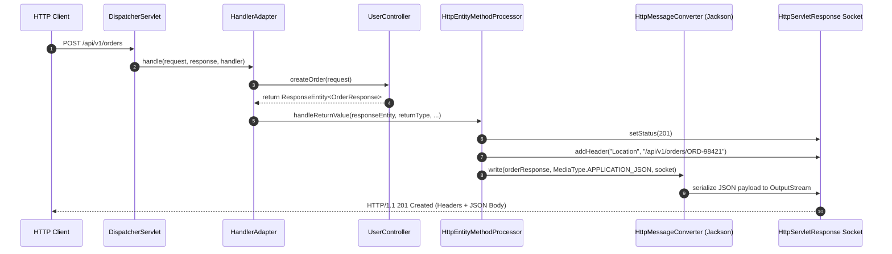
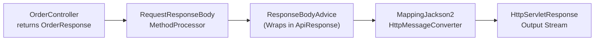

# Response Handling: ResponseEntity, Status Codes & Custom Response Envelopes

In our earlier explorations of [Spring MVC Architecture](/notes/spring-mvc-architecture-dispatcherservlet-handlermappings-httpmessageconverters) and [REST Controllers](/notes/spring-boot-rest-controllers-path-variables-request-bodies-headers), we examined the **ingress journey**: how incoming HTTP requests are received by the `DispatcherServlet`, resolved by `HandlerMapping`, executed via `HandlerAdapter`, and bound to validated domain parameters.

Now, we examine the equally critical **egress journey**:

> *"When your business logic finishes executing, how should your application speak back to the outside world? What does an HTTP client—whether a browser SPA, a mobile app, an edge reverse proxy, or an upstream microservice—actually need from your response?"*

In distributed systems, an API response is far more than a serialized JSON string. It is a **formal protocol contract** governing caching, security, routing, idempotency, and failure recovery across network boundaries.

```
+-----------------------------------------------------------------------------------+
|                        The Three Pillars of an HTTP Response                      |
+-----------------------------------------------------------------------------------+
|  1. STATUS LINE  : Protocol + Semantic Code + Reason (HTTP/1.1 201 Created)       |
|  2. HEADERS      : Transport & Caching Directives (Location, ETag, Cache-Control) |
|  3. BODY         : Serialized Representation (Domain DTO, Envelope, or Empty)     |
+-----------------------------------------------------------------------------------+
```

---

## 01. First Principles: The Anatomy of an HTTP Response & `ResponseEntity<T>`

### The Courier Parcel Delivery Analogy

To build an intuitive mental model of HTTP response handling, consider an **international courier delivery**:

- **The Status Code is the Hub Delivery Scan**: It tells customs and logistics handlers the structural state of the package (`201` = *Checked into warehouse as a newly registered asset*; `202` = *Accepted for sorting on the overnight freight flight*; `204` = *Notice acknowledged, no package returned*; `304` = *Customer already possesses identical package, delivery skipped*; `401` = *Customs clearance failed, missing identity passport*; `403` = *Restricted item, recipient lacks handling license*; `409` = *Locker code already claimed by another shipment*).
- **The Headers are the Shipping Manifest & Seals**: Affixed to the outside of the box, headers provide metadata without requiring anyone to open the package (`Location` points to the destination locker, `Cache-Control` specifies shelf life before spoilage, `ETag` is the tamper-evident holographic seal, and `X-Trace-Id` is the barcode routing tracking number).
- **The Body is the Physical Item Inside the Box**: The actual payload (a laptop, an invoice document, or empty packaging foam).

When a developer writes a controller method that returns a bare POJO:

```java
// BARE POJO RETURN: Throws unboxed item over the fence
@GetMapping("/users/{id}")
public UserResponse getUser(@PathVariable UUID id) {
    return userService.findById(id);
}
```

You are essentially throwing an unpackaged item onto the customer's lawn with a generic green `"200 OK"` sticker slapped on it. In a simple local prototype, this works. In an enterprise system, however, you lose control over the transport boundary:
1. You cannot dynamically return `201 Created` on resource creation or `204 No Content` on deletion.
2. You cannot attach canonical `Location` headers or cryptographic `ETag` validation tokens.
3. You cannot instruct CDNs or edge proxies how to cache or revalidate the resource.

---

### The Egress Pipeline: How Spring MVC Emits Responses

Recall from [Spring MVC Architecture](/notes/spring-mvc-architecture-dispatcherservlet-handlermappings-httpmessageconverters) that after a handler method executes, the `RequestMappingHandlerAdapter` delegates the return value to a chain of `HandlerMethodReturnValueHandler` implementations:



For controller methods returning `ResponseEntity<T>`, the designated handler is **`HttpEntityMethodProcessor`**:
1. **Status Code Application**: It extracts the `HttpStatusCode` and executes `HttpServletResponse.setStatus(code.value())` on the container's raw network socket.
2. **Header Flushing**: It iterates through `HttpHeaders` and writes each key-value pair to the response buffer.
3. **Payload Content Negotiation**: If a body `T` exists, it invokes `HttpMessageConverter` (such as `MappingJackson2HttpMessageConverter`) to serialize the body into JSON. If the entity is headless (`ResponseEntity<Void>` or body is `null`), serialization is bypassed, and the HTTP socket completes with zero content bytes.

---

### Fluent Builders vs. Constructors

While `ResponseEntity` provides public constructors, production code should strictly favor Spring's **fluent builder API**. Fluent builders prevent argument-order mistakes, improve readability, and ensure type safety:

```java
@RestController
@RequestMapping("/api/v1/orders")
public class OrderController {

    private final OrderService orderService;

    public OrderController(OrderService orderService) {
        this.orderService = orderService;
    }

    // 200 OK with body
    @GetMapping("/{id}")
    public ResponseEntity<OrderResponse> getOrder(@PathVariable UUID id) {
        OrderResponse order = orderService.findById(id);
        return ResponseEntity.ok(order);
    }

    // 201 Created with canonical Location header and body
    @PostMapping
    public ResponseEntity<OrderResponse> createOrder(@Valid @RequestBody CreateOrderRequest request) {
        OrderResponse created = orderService.create(request);
        URI location = ServletUriComponentsBuilder.fromCurrentRequest()
                .path("/{id}")
                .buildAndExpand(created.id())
                .toUri();
        return ResponseEntity.created(location).body(created);
    }

    // 204 No Content for successful deletion
    @DeleteMapping("/{id}")
    public ResponseEntity<Void> deleteOrder(@PathVariable UUID id) {
        orderService.delete(id);
        return ResponseEntity.noContent().build();
    }
}
```

---

## 02. The HTTP Status Code Decision Hierarchy

Status codes are the universal lingua franca of the web. Reverse proxies (Nginx, Envoy), API gateways (Spring Cloud Gateway, Kong), edge CDNs (Cloudflare, Fastly), client networking libraries (Axios, OkHttp, Spring WebClient), and circuit breakers (Resilience4j) make critical operational decisions based purely on the status code family.

```
                              HTTP Status Code Hierarchy
                                          |
        +------------------+--------------+-------------+------------------+
        |                  |                            |                  |
       1xx                2xx                          4xx                5xx
  Informational         Success                    Client Error       Server Error
  - 101 Switching    - 200 OK                     - 400 Bad Request  - 500 Internal Error
    Protocols        - 201 Created (+ Location)   - 401 Unauth       - 502 Bad Gateway
                     - 202 Accepted (Async)       - 403 Forbidden    - 503 Unavailable
                     - 204 No Content             - 404 Not Found    - 504 Gateway Timeout
                                                  - 409 Conflict
                                                  - 422 Unprocessable
```

---

### The 2xx Success Family: Operational Context & Use Cases

#### 1. `200 OK` (Standard Success)
Use for successful `GET`, `PUT`, or `PATCH` requests where the server returns a resource representation.
- **Application Context**: A customer views their profile (`GET /api/v1/users/me`), or updates their notification preferences via `PUT /api/v1/users/me/notifications`. The response payload contains the updated resource representation.

#### 2. `201 Created` (Resource Creation)
Mandatory whenever a request creates a new, addressable resource on the server.
- **Application Context**: A checkout workflow where a shopper submits payment for an order (`POST /api/v1/orders`). The system mints a new database record and returns `201 Created`.
- **Architectural Requirement**: Must be paired with a canonical `Location` header (e.g., `Location: /api/v1/orders/ORD-98421`). If a mobile client experiences a network glitch right after submission, it can read the `Location` header to query the new order's state without risking a duplicate transaction.

#### 3. `202 Accepted` (Asynchronous / Batch Workflows)
Signifies that the request has been validated and accepted for processing, but execution is not yet complete (and may not have begun).
- **Application Context**: Banking year-end statement PDF generation, bulk-importing 100,000 inventory records, or running an AI video transcoding job.
- **Why It Matters**: Holding an HTTP worker thread open for 45 seconds while generating a PDF starves the Servlet container thread pool (e.g., Tomcat's default 200 worker threads). Under high concurrency, this causes cascading outages. With `202 Accepted`, the controller publishes a message to Kafka or RabbitMQ, immediately releases the HTTP thread within 2 milliseconds, and returns a job status tracking URL:
  ```http
  HTTP/1.1 202 Accepted
  Location: /api/v1/jobs/TAX-2026-X89
  ```

#### 4. `204 No Content` (Headless Completion)
Indicates that the operation succeeded, but the response body is intentionally empty.
- **Application Context**: 
  - Deleting a draft order: `DELETE /api/v1/orders/drafts/123`.
  - An IoT telemetry heartbeat: 500,000 connected smart thermostats sending status pings every 60 seconds. Returning a 1 KB JSON payload (`{"status":"ok"}`) across 500,000 devices generates terabytes of unnecessary outbound network traffic. Returning `204 No Content` transmits 0 payload bytes, saving significant cloud bandwidth costs.

---

### The 4xx Client Error Family: Guiding the Consumer

The 4xx family indicates that the client made an error in the request syntax, credentials, or state prerequisites.

| Status Code | Semantic Meaning | Real-World Application Scenario |
| :--- | :--- | :--- |
| **`400 Bad Request`** | Malformed syntax / parsing failure | Client sends malformed JSON syntax (missing bracket) or incompatible parameter types (passing `"abc"` to an integer field). |
| **`401 Unauthorized`** | Missing or invalid authentication | Missing Bearer token, expired JWT, or invalid API key. Server says: *"Who are you? Prove your identity."* |
| **`403 Forbidden`** | Authenticated, but lacks permissions | User authenticated as `ROLE_CUSTOMER` attempts to delete a product via an Admin endpoint. Server says: *"I know who you are, but you cannot touch this."* |
| **`404 Not Found`** | Resource does not exist | Client requests `/api/v1/orders/99999` which does not exist in the database, or accessing an unmapped path. |
| **`405 Method Not Allowed`** | HTTP verb not supported on route | Sending `POST` to a read-only reporting endpoint (`GET /api/v1/reports/summary`). Spring automatically includes an `Allow: GET` header. |
| **`409 Conflict`** | State collision / optimistic lock failure | Two concurrent ticket buyers click "Reserve Seat A-12" at the exact same millisecond. Or registering with an email that is already taken. |
| **`410 Gone`** | Permanently purged resource | A promotional campaign endpoint has been retired permanently. Signals search indexers and mobile clients to stop requesting it. |
| **`415 Unsupported Media Type`** | Client sent unsupported Content-Type | Client submits payload with `Content-Type: text/xml` to an endpoint that only accepts `application/json`. |
| **`422 Unprocessable Content`** | Syntactically valid JSON, semantic domain violation | Jakarta validation fails (`@NotBlank`, `@Min`), or cross-field validation rules fail (e.g., `checkoutDate` is before `checkinDate`). |
| **`429 Too Many Requests`** | Rate limit or quota exhausted | Tenant exceeds 500 requests per minute. Accompanied by a `Retry-After: 30` header. |

#### The Architectural Line: `401 Unauthorized` vs. `403 Forbidden`

Conflating 401 and 403 is one of the most disruptive flaws in modern API design:

- **When a client receives `401 Unauthorized`**: Mobile and web clients intercept this status to initiate authentication recovery—either by executing a silent OAuth2 refresh token exchange or by prompting biometric/password login.
- **When a client receives `403 Forbidden`**: The user is already authenticated. Their identity is verified, but their authorization tier is insufficient. A 403 must **never** trigger a re-login flow. If a mobile app attempts to refresh tokens or log the user in again on a 403, the user enters an **infinite login loop** because logging in with the same account will consistently yield another 403. Instead, the UI displays an explicit "Access Denied" view.

---

### The 5xx Server Error Family: Infrastructure & Fault Isolation

The 5xx family indicates that the client request was completely valid, but the server failed to process it:

- **`500 Internal Server Error`**: An unhandled runtime exception (such as a `NullPointerException` or unhandled database driver failure).
- **`502 Bad Gateway`**: The service acted as a proxy or gateway and received an invalid or unparseable response from an upstream microservice (e.g., an internal billing service dropped the TCP socket mid-stream).
- **`503 Service Unavailable`**: The service is temporarily unable to handle traffic due to maintenance or load shedding. In resilient microservices, this is emitted when a Resilience4j circuit breaker trips to open state or when incoming request queues exceed capacity.
- **`504 Gateway Timeout`**: An upstream dependency or third-party payment gateway failed to return a response before the HTTP client's read timeout elapsed.

---

### Production Decision Flowchart

Use this decision tree to select the exact HTTP status code for any controller operation:


---

## 03. The `Location` Header Contract & Dynamic URI Construction

### The RFC 9110 Requirement for `201 Created`

When an endpoint creates a resource, returning `201 Created` alone is incomplete under RFC 9110. The server **must** identify the newly minted entity by setting a canonical `Location` header field:

```http
HTTP/1.1 201 Created
Location: https://api.store.com/api/v1/orders/ORD-98421
Content-Type: application/json

{
  "id": "ORD-98421",
  "status": "PENDING_PAYMENT",
  "totalAmount": 149.50
}
```

---

### Why Hardcoded Strings Fail in Cloud Topologies

Consider what happens when a developer constructs the location URI using string concatenation:

```java
// ANTI-PATTERN: Hardcoded string concatenation
URI location = URI.create("http://localhost:8080/api/v1/orders/" + order.getId());
```

In modern cloud environments, this breaks immediately:

```
[ Client Browser / Mobile ] (https://api.mycompany.com)
            |
            v  TLS Terminated at Port 443
[ AWS ALB / Cloudflare / Ingress ]
            |
            v  Plain HTTP forwarded to internal Pod Port 8080
[ Spring Boot Container ] (Listening on 0.0.0.0:8080)
            |
            +--> Hardcoded URL produces: "http://localhost:8080/api/v1/orders/123"
```

1. **Protocol Mismatch (Mixed Content)**: The browser connected over secure HTTPS, but received an unencrypted `http://` URI in the `Location` header. Modern web browsers block subsequent requests to that URI under **Mixed Content Security Restrictions**.
2. **Port Leaks**: The external client connects to standard port 443, but the internal container runs on port 8080. Returning `:8080` directs clients to an unreachable internal port.
3. **Gateway Prefix Stripping**: An API Gateway might route `/services/order-service/api/v1/orders` to the container's local `/api/v1/orders`. Hardcoding paths strips the gateway routing prefix.

---

### Dynamic Resolution with `ServletUriComponentsBuilder`

Spring provides `ServletUriComponentsBuilder` to construct URIs dynamically from the current request context:

```java
@PostMapping
public ResponseEntity<OrderResponse> createOrder(@Valid @RequestBody CreateOrderRequest request) {
    OrderResponse createdOrder = orderService.createOrder(request);

    URI location = ServletUriComponentsBuilder
            .fromCurrentRequest()                  // Captures base: https://api.mycompany.com/api/v1/orders
            .path("/{id}")                         // Appends template: /{id}
            .buildAndExpand(createdOrder.id())     // Resolves: ORD-98421
            .toUri();                              // Final URI

    return ResponseEntity.created(location).body(createdOrder);
}
```

#### Configuring Reverse Proxy Header Preservation
For `ServletUriComponentsBuilder` to inherit the public domain and HTTPS protocol behind Nginx, AWS ALB, or Envoy, tell Spring Boot to honor `X-Forwarded-Proto`, `X-Forwarded-Host`, and `X-Forwarded-Port`:

```yaml
# application.yml
server:
  forward-headers-strategy: framework
```

When set to `framework`, Spring's internal `ForwardedHeaderFilter` intercepts the request before it reaches your controller, rewriting the internal request context so that `ServletUriComponentsBuilder.fromCurrentRequest()` generates fully qualified, secure public URLs.

---

## 04. Unified Enterprise Response Envelopes: Architectural Blueprint

### The Multi-Team Coordination Problem

In large-scale microservice architectures, different engineering teams often build endpoints with divergent response shapes:
- **Billing Team**: `{ "invoice": { ... }, "paid": true }`
- **Catalog Team**: `{ "data": { ... }, "status": "SUCCESS" }`
- **Auth Team**: `{ "token": "...", "expiresIn": 3600 }`
- **Error Formats**: Some return `{ "error": "msg" }`, others `{ "errorMessage": "msg" }`, and others `{ "errors": [ ... ] }`.

This lack of standardization places an immense burden on frontend and mobile teams. Every single client network call requires custom parsing logic, custom error banners, and ad-hoc pagination handling.

To establish company-wide consistency, enterprise organizations implement a **Unified Response Envelope** (`ApiResponse<T>`):

```
+-----------------------------------------------------------------------------------+
|                            Unified Enterprise Envelope                            |
+-----------------------------------------------------------------------------------+
| {                                                                                 |
|   "success": true,                                  <-- Boolean execution flag    |
|   "code": 200,                                      <-- Status code mirror        |
|   "message": "Resource retrieved successfully",     <-- Human-readable summary    |
|   "data": { ... },                                  <-- Generic domain payload T  |
|   "meta": {                                         <-- Pagination & context      |
|     "page": 1,                                                                    |
|     "size": 20,                                                                   |
|     "totalElements": 1420,                                                        |
|     "totalPages": 71                                                              |
|   },                                                                              |
|   "traceId": "c4b92f3577b34da6a3ce929d0e0e4736",    <-- Distributed tracing ID    |
|   "timestamp": "2026-11-15T14:30:00Z"               <-- ISO-8601 UTC timestamp    |
| }                                                                                 |
+-----------------------------------------------------------------------------------+
```

### Why Include `traceId` Directly in the Payload?

HTTP response headers often carry tracing tokens (e.g., `X-Trace-Id`). However, in corporate networks, third-party proxies, API gateways, or cross-origin browser policies (CORS) frequently strip custom response headers before the client JavaScript code can inspect them.

By embedding the `traceId` directly inside the JSON envelope, when a mobile user encounters an error and submits a bug report or screenshot, the customer support team has immediate access to the exact OpenTelemetry / Zipkin trace ID to locate the backend log lines in Datadog or Grafana.

---

### Production Implementation with Java 21 Records

```java
package com.enterprise.common.response;

import com.fasterxml.jackson.annotation.JsonInclude;
import java.time.Instant;

@JsonInclude(JsonInclude.Include.NON_NULL)
public record ApiResponse<T>(
        boolean success,
        int code,
        String message,
        T data,
        PageMetadata meta,
        String traceId,
        Instant timestamp
) {
    // Static factory for standard successful responses
    public static <T> ApiResponse<T> success(T data, String message, String traceId) {
        return new ApiResponse<>(
                true,
                200,
                message,
                data,
                null,
                traceId,
                Instant.now()
        );
    }

    // Static factory for paginated responses
    public static <T> ApiResponse<T> paginated(T data, PageMetadata meta, String traceId) {
        return new ApiResponse<>(
                true,
                200,
                "OK",
                data,
                meta,
                traceId,
                Instant.now()
        );
    }
}
```

```java
package com.enterprise.common.response;

public record PageMetadata(
        int page,
        int size,
        long totalElements,
        int totalPages
) {}
```

---

### Tradeoffs: Envelopes vs. Raw Payloads vs. RFC 9457 ProblemDetail

| Architectural Dimension | Unified Envelope (`ApiResponse<T>`) | Raw Domain DTOs | RFC 9457 ProblemDetail Standard |
| :--- | :--- | :--- | :--- |
| **Primary Audience** | Internal enterprise microservices, SPAs, company mobile apps. | Public open APIs, developer platform ecosystems. | Industry-standard HTTP error handling across all clients. |
| **Client Deserialization** | Single generic client wrapper handles metadata and trace IDs uniformly. | Zero envelope nesting; DTO maps directly into client model classes. | Standardized JSON structure for errors (`type`, `title`, `status`, `detail`, `instance`). |
| **Streaming / Binary Support** | Incompatible: breaks byte buffers, SSE event streams, and CSV exports. | Native support for streaming binary arrays and event streams. | Not applicable (error-only format). |

> **Production Recommendation**: Standardize on `ApiResponse<T>` envelopes for internal business success payloads, while using the native Spring Boot 3 **RFC 9457 `ProblemDetail`** specification for 4xx and 5xx error responses.

---

## 05. Automating Response Envelopes via `ResponseBodyAdvice<T>`

### The Boilerplate Anti-Pattern

Requiring every controller method to manually wrap its domain data creates severe code duplication:

```java
// BOILERPLATE POLLUTION: Manually wrapping every return statement
@GetMapping("/{id}")
public ResponseEntity<ApiResponse<UserResponse>> getUser(@PathVariable UUID id) {
    UserResponse user = userService.findById(id);
    String traceId = tracer.currentSpan().context().traceId();
    return ResponseEntity.ok(ApiResponse.success(user, "User retrieved", traceId));
}
```

This pollutes controller method signatures with three levels of generics (`ResponseEntity<ApiResponse<PageResponse<UserDto>>>>`), clutters unit tests, and invites human error when a developer forgets to wrap a response.

---

### The Solution: The `ResponseBodyAdvice` Interceptor

Spring MVC provides `ResponseBodyAdvice<T>`, an interceptor hook that executes inside `RequestResponseBodyMethodProcessor`. It intercepts controller return values **after** the handler method finishes, but **before** Jackson serializes the data to the HTTP socket:



### Production Implementation

```java
package com.enterprise.common.advice;

import com.enterprise.common.annotation.NoEnvelope;
import com.enterprise.common.response.ApiResponse;
import org.springframework.core.MethodParameter;
import org.springframework.http.MediaType;
import org.springframework.http.converter.HttpMessageConverter;
import org.springframework.http.server.ServerHttpRequest;
import org.springframework.http.server.ServerHttpResponse;
import org.springframework.web.bind.annotation.RestControllerAdvice;
import org.springframework.web.servlet.mvc.method.annotation.ResponseBodyAdvice;

import java.util.UUID;

@RestControllerAdvice
public class GlobalEnvelopeAdvice implements ResponseBodyAdvice<Object> {

    @Override
    public boolean supports(MethodParameter returnType, 
                            Class<? extends HttpMessageConverter<?>> converterType) {
        // Bypass Swagger / OpenAPI documentation endpoints
        String declaringClass = returnType.getDeclaringClass().getName();
        if (declaringClass.contains("org.springdoc") || declaringClass.contains("springfox")) {
            return false;
        }

        // Bypass endpoints explicitly annotated with @NoEnvelope
        if (returnType.hasMethodAnnotation(NoEnvelope.class) || 
            returnType.getDeclaringClass().isAnnotationPresent(NoEnvelope.class)) {
            return false;
        }

        // Bypass raw String returns to prevent StringHttpMessageConverter ClassCastException
        return !returnType.getParameterType().equals(String.class);
    }

    @Override
    public Object beforeBodyWrite(Object body,
                                  MethodParameter returnType,
                                  MediaType selectedContentType,
                                  Class<? extends HttpMessageConverter<?>> selectedConverterType,
                                  ServerHttpRequest request,
                                  ServerHttpResponse response) {

        // If already wrapped or is an error descriptor, pass through unchanged
        if (body instanceof ApiResponse<?>) {
            return body;
        }

        String traceId = resolveTraceId(request);
        return ApiResponse.success(body, "Operation successful", traceId);
    }

    private String resolveTraceId(ServerHttpRequest request) {
        var header = request.getHeaders().getFirst("X-Trace-Id");
        return (header != null && !header.isBlank()) ? header : UUID.randomUUID().toString();
    }
}
```

Now, your controllers return clean, uncluttered domain records:

```java
@GetMapping("/{id}")
public UserResponse getUser(@PathVariable UUID id) {
    return userService.findById(id); // Automatically wrapped in ApiResponse<UserResponse>!
}
```

---

### The Dangerous `StringHttpMessageConverter` ClassCastException Trap

A notorious trap awaits developers using `ResponseBodyAdvice`: **Controller methods that return raw `String`**.

```java
@GetMapping("/ping")
public String ping() {
    return "pong"; // DANGER: Will crash under ResponseBodyAdvice!
}
```

#### Why This Crashes
1. When Spring evaluates a method returning `String`, content negotiation selects **`StringHttpMessageConverter`** *before* `ResponseBodyAdvice` runs.
2. `ResponseBodyAdvice.beforeBodyWrite()` intercepts `"pong"` and wraps it into an `ApiResponse<String>` object.
3. Spring then attempts to pass this `ApiResponse` object to `StringHttpMessageConverter`, which expects a raw `java.lang.String`.
4. The JVM immediately throws:
   ```
   java.lang.ClassCastException: class com.enterprise.common.response.ApiResponse 
   cannot be cast to class java.lang.String
   ```

#### Prevention Rule
1. **Always return strongly typed Records or DTOs** (e.g., `record PingResponse(String status) {}`).
2. **Explicitly filter out `String.class`** inside `supports()`.

---

## 06. Protocol Headers, Caching Directives & Streaming

Beyond status codes and JSON bodies, high-performance APIs leverage HTTP response headers to eliminate redundant network roundtrips and conserve memory.

### Edge and Browser Caching via `Cache-Control`

By default, API responses are not cached by CDNs or web browsers unless explicit caching headers are present.

Spring's `ResponseEntity` provides a type-safe builder for RFC 9111 caching directives:

```java
@GetMapping("/catalog/products/{id}")
public ResponseEntity<ProductResponse> getProduct(@PathVariable UUID id) {
    ProductResponse product = catalogService.findById(id);

    return ResponseEntity.ok()
            .cacheControl(CacheControl.maxAge(30, TimeUnit.MINUTES)
                    .cachePublic()
                    .mustRevalidate())
            .body(product);
}
```

This emits:
```http
Cache-Control: public, max-age=1800, must-revalidate
```
Edge reverse proxies will cache this response for 30 minutes, protecting your database from high-volume read traffic.

---

### Entity Validation with `ETag` (Conditional `304 Not Modified`)

An `ETag` (Entity Tag) is a cryptographic hash or version identifier representing a specific state of a resource. 

When a client queries a resource, the server attaches an `ETag`:
```http
HTTP/1.1 200 OK
ETag: "v4-a8f5b2c9"
```

On subsequent requests, the client transmits that value back in the **`If-None-Match`** request header:
```http
GET /catalog/products/100 HTTP/1.1
If-None-Match: "v4-a8f5b2c9"
```

The server compares the client's token with the current resource hash. If identical, the server immediately returns **`304 Not Modified`** with zero response body:

```java
@GetMapping("/catalog/products/{id}")
public ResponseEntity<ProductResponse> getProduct(
        @PathVariable UUID id,
        @RequestHeader(value = "If-None-Match", required = false) String ifNoneMatch) {

    ProductEntity entity = catalogService.getRawEntity(id);
    String currentEtag = "\"" + entity.getVersion() + "-" + entity.getUpdatedAt().toEpochMilli() + "\"";

    if (currentEtag.equals(ifNoneMatch)) {
        return ResponseEntity.status(HttpStatus.NOT_MODIFIED).build();
    }

    return ResponseEntity.ok()
            .eTag(currentEtag)
            .body(ProductResponse.from(entity));
}
```

**Real-World Value**: During major shopping events (e.g., Black Friday), millions of shoppers refresh popular product pages. Emitting `304 Not Modified` eliminates database serialization, avoids JSON generation, and reduces outbound network bandwidth by up to 99%.

---

### Safe Binary Streaming without Memory Exhaustion

When serving large files (e.g., 500 MB CSV financial reports or PDF statements), loading the entire byte array into memory (`byte[]`) creates massive JVM heap pressure, triggering Garbage Collection pauses or `OutOfMemoryError`.

Instead, stream the file directly from disk or storage using Spring's `InputStreamResource`:

```java
@GetMapping("/{id}/statement")
public ResponseEntity<Resource> downloadStatement(@PathVariable UUID id) {
    InputStream stream = statementService.generateStream(id);
    InputStreamResource resource = new InputStreamResource(stream);

    return ResponseEntity.ok()
            .contentType(MediaType.APPLICATION_PDF)
            .header(HttpHeaders.CONTENT_DISPOSITION, "attachment; filename=\"statement-" + id + ".pdf\"")
            .body(resource);
}
```

Spring MVC reads from the `InputStream` and streams chunks directly into the Servlet container's network socket, keeping memory usage constant regardless of file size.

---

## 07. Production Anti-Patterns & Catastrophic Pitfalls

### Anti-Pattern 1: The "200 OK with Error Inside" Disaster

The single most destructive practice in web API engineering is returning `200 OK` when a business failure occurs:

```http
HTTP/1.1 200 OK
Content-Type: application/json

{
  "status": "ERROR",
  "errorCode": "CARD_DECLINED",
  "message": "Insufficient funds in customer account."
}
```

```
[ Client Request ]
       |
       v
[ Edge CDN / Cloudflare ] <--- Sees "200 OK" -> CACHES ERROR FOR 1 HOUR!
       |
       v
[ API Gateway / Envoy ]   <--- Sees "200 OK" -> Reports 100% Success in SLOs!
       |
       v
[ Resilience4j Circuit ] <--- Sees "200 OK" -> Breaker NEVER TRIPS during database crash!
       |
       v
[ Downstream Service Down ]
```

#### The Cascading Consequences:
1. **Corrupted Edge Caching**: CDNs and reverse proxies treat `200 OK` as successful, cacheable data. If a payment service fails and returns `200 OK` with an error payload, the CDN may cache that error page and serve `"CARD_DECLINED"` to subsequent unrelated customers.
2. **Blind Observability**: Monitoring tools (Prometheus, Datadog) compute service error rates and Service Level Objectives (SLOs) by tracking the ratio of 4xx/5xx responses to 2xx responses. When errors return `200 OK`, your dashboards report 100% uptime while your customers experience 100% failure.
3. **Disabled Circuit Breakers**: Resilience4j and Istio evaluate network failure rates. If your database crashes and the controller catches the exception to return `200 OK with {"error": "DB_OFFLINE"}`, the circuit breaker will never trip to shed load.
4. **Client Interceptor Bypass**: Networking libraries (Axios, OkHttp, Spring WebClient) automatically execute error interceptors on 4xx/5xx responses. When errors return 200, frontend engineers must manually inspect JSON fields on every single network call.

> **Rule of Law**: Use HTTP status codes to communicate structural and operational outcomes. Never hide errors inside `200 OK`.

---

### Anti-Pattern 2: Returning `200 OK` with Empty or Null Bodies

When an operation produces no payload (such as `DELETE` or an asynchronous trigger), returning `200 OK` with zero bytes violates HTTP semantics:

```java
// ANTI-PATTERN: Returning 200 with no body
@DeleteMapping("/{id}")
public ResponseEntity<Void> deleteUser(@PathVariable UUID id) {
    userService.delete(id);
    return ResponseEntity.ok().build(); // Emits 200 with 0 bytes
}
```

Many client-side JSON parsers crash with `Unexpected end of JSON input` when encountering a `200 OK` status with an empty body.

**The Remedy**: Always return `204 No Content` for headless operations:
```java
return ResponseEntity.noContent().build();
```

---

### Anti-Pattern 3: Exposing Database Stack Traces (CWE-209)

Returning raw exception messages in 500 error responses creates a critical security vulnerability:

```json
// SECURITY VULNERABILITY: Stack trace exposure
{
  "timestamp": "2026-11-15T14:35:00Z",
  "status": 500,
  "error": "Internal Server Error",
  "trace": "org.postgresql.util.PSQLException: ERROR: relation \"users\" does not exist..."
}
```

Attackers analyze stack traces to determine PostgreSQL versions, internal schema table names, and vulnerable third-party dependencies.

**The Remedy**: Suppress stack traces globally in `application.yml`:
```yaml
server:
  error:
    include-stacktrace: never
    include-message: never
```

---

## 08. Complete Production Blueprint: An Enterprise Order Management Service

To synthesize all concepts explored in this lesson, here is an enterprise **Order Management Controller** using Java 21 Records, fluent `ResponseEntity` builders, canonical `Location` headers, conditional `ETag` evaluation, and asynchronous processing.

### The Domain Contracts

```java
package com.store.order.api.dto;

import jakarta.validation.constraints.DecimalMin;
import jakarta.validation.constraints.NotEmpty;
import jakarta.validation.constraints.NotNull;
import java.math.BigDecimal;
import java.time.Instant;
import java.util.List;
import java.util.UUID;

public record CreateOrderRequest(
        @NotNull UUID customerId,
        @NotEmpty List<OrderItemDto> items,
        @NotNull @DecimalMin("0.01") BigDecimal totalAmount
) {}

public record OrderItemDto(
        @NotNull UUID productId,
        int quantity,
        BigDecimal unitPrice
) {}

public record OrderResponse(
        UUID id,
        UUID customerId,
        String status,
        BigDecimal totalAmount,
        long version,
        Instant createdAt
) {}

public record BatchCancelResponse(
        UUID batchJobId,
        String status,
        int affectedCount,
        Instant scheduledAt
) {}
```

---

### The Production Controller Implementation

```java
package com.store.order.api;

import com.store.order.api.dto.BatchCancelResponse;
import com.store.order.api.dto.CreateOrderRequest;
import com.store.order.api.dto.OrderResponse;
import com.store.order.service.OrderService;
import jakarta.validation.Valid;
import org.springframework.http.CacheControl;
import org.springframework.http.HttpStatus;
import org.springframework.http.MediaType;
import org.springframework.http.ResponseEntity;
import org.springframework.web.bind.annotation.*;
import org.springframework.web.servlet.support.ServletUriComponentsBuilder;

import java.net.URI;
import java.util.List;
import java.util.UUID;
import java.util.concurrent.TimeUnit;

@RestController
@RequestMapping(path = "/api/v1/orders", produces = MediaType.APPLICATION_JSON_VALUE)
public class OrderController {

    private final OrderService orderService;

    public OrderController(OrderService orderService) {
        this.orderService = orderService;
    }

    /**
     * 201 Created: Creates a new order.
     * Enforces the RFC 9110 Location header contract pointing to the canonical URI.
     */
    @PostMapping(consumes = MediaType.APPLICATION_JSON_VALUE)
    public ResponseEntity<OrderResponse> createOrder(@Valid @RequestBody CreateOrderRequest request) {
        OrderResponse createdOrder = orderService.createOrder(request);

        // Dynamically construct canonical location respecting reverse proxy headers
        URI location = ServletUriComponentsBuilder
                .fromCurrentRequest()
                .path("/{id}")
                .buildAndExpand(createdOrder.id())
                .toUri();

        return ResponseEntity
                .created(location)
                .body(createdOrder);
    }

    /**
     * 200 OK with ETag & Cache-Control: Retrieves order details.
     * Evaluates If-None-Match to emit 304 Not Modified when unchanged.
     */
    @GetMapping("/{id}")
    public ResponseEntity<OrderResponse> getOrder(
            @PathVariable UUID id,
            @RequestHeader(value = "If-None-Match", required = false) String ifNoneMatch) {

        OrderResponse order = orderService.findById(id);

        // Compute strong entity tag based on entity ID and version
        String currentEtag = "\"" + order.id() + "-v" + order.version() + "\"";

        // Conditional validation check: return 304 if client cache is fresh
        if (currentEtag.equals(ifNoneMatch)) {
            return ResponseEntity
                    .status(HttpStatus.NOT_MODIFIED)
                    .eTag(currentEtag)
                    .build();
        }

        return ResponseEntity.ok()
                .cacheControl(CacheControl.maxAge(60, TimeUnit.SECONDS).cachePrivate())
                .eTag(currentEtag)
                .body(order);
    }

    /**
     * 202 Accepted: Dispatches a long-running batch cancellation workflow.
     * Enqueues the task, frees the HTTP worker thread immediately, and provides a status tracking URL.
     */
    @PostMapping("/batch-cancellations")
    public ResponseEntity<BatchCancelResponse> batchCancel(@RequestBody List<UUID> orderIds) {
        BatchCancelResponse job = orderService.enqueueBatchCancellation(orderIds);

        URI statusTrackingUri = ServletUriComponentsBuilder
                .fromCurrentContextPath()
                .path("/api/v1/jobs/{jobId}")
                .buildAndExpand(job.batchJobId())
                .toUri();

        return ResponseEntity
                .accepted()
                .location(statusTrackingUri)
                .body(job);
    }

    /**
     * 204 No Content: Purges an unconfirmed draft order.
     * Emits zero response body bytes to conserve egress bandwidth.
     */
    @DeleteMapping("/{id}/draft")
    public ResponseEntity<Void> deleteDraftOrder(@PathVariable UUID id) {
        orderService.deleteDraftOrder(id);
        return ResponseEntity.noContent().build();
    }
}
```

---

## 09. Authoritative References & Further Reading

To explore HTTP semantics, status code RFC specifications, and Spring MVC response processing internals at the source, consult these canonical resources:

- [RFC 9110: HTTP Semantics (Field Definitions & Status Codes)](https://www.rfc-editor.org/rfc/rfc9110.html)  
  *The authoritative Internet Standard defining safe and idempotent HTTP methods, status code semantics (2xx, 3xx, 4xx, 5xx), and Location header specifications.*
- [Spring Framework Official Documentation — HttpEntity & ResponseEntity](https://docs.spring.io/spring-framework/reference/web/webmvc/mvc-controller/params/httpentity.html)  
  *Comprehensive guide to the ResponseEntity model, fluent builder hierarchies, and HttpEntityMethodProcessor mechanics.*
- [Spring Framework Official Documentation — ResponseBodyAdvice Architecture](https://docs.spring.io/spring-framework/reference/web/webmvc/mvc-controller/ann-advice.html)  
  *Deep dive into global controller advisories, response interception hooks, and custom serialization pipelines.*
- [RFC 9457: Problem Details for HTTP APIs](https://www.rfc-editor.org/rfc/rfc9457.html)  
  *The official standard defining machine-readable problem details for HTTP APIs, natively implemented via Spring Boot 3's ProblemDetail API.*
- [RFC 8288: Web Linking & Canonical Discovery](https://www.rfc-editor.org/rfc/rfc8288.html)  
  *Foundational specification governing relation types, canonical resource linking, and navigational metadata across REST APIs.*
