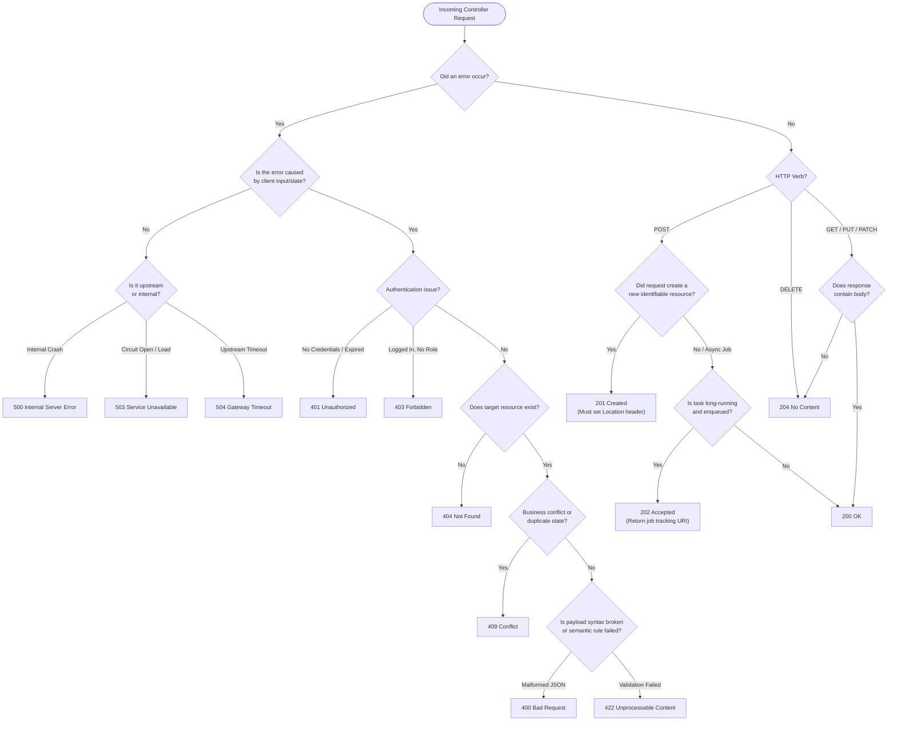

# Response Handling: ResponseEntity, Status Codes & Custom Response Envelopes

In our journey through [Spring MVC Architecture](/notes/spring-mvc-architecture-dispatcherservlet-handlermappings-httpmessageconverters) and [REST Controllers](/notes/spring-boot-rest-controllers-path-variables-request-bodies-headers), we examined how incoming HTTP requests traverse the `DispatcherServlet`, map to handler methods, and bind payload data. 

Now, we address the equally critical reverse journey: **how your application speaks back to the outside world**.

When an HTTP client invokes a microservice endpoint, it does not merely expect raw data; it relies on a **formal protocol contract**. That contract is expressed through three dimensions:
1. **The HTTP Status Code**: Communicates the structural outcome of the operation (success, async acceptance, client error, concurrency conflict, or infrastructure failure) in a standardized language understood by edge caches, reverse proxies, and API gateways.
2. **HTTP Response Headers**: Convey protocol-level metadata, such as resource locations (`Location`), cache expiration instructions (`Cache-Control`), entity change validation tokens (`ETag`), and distributed correlation identifiers (`X-Trace-Id`).
3. **The Response Body**: Contains the serialized payload, formatted either as domain data, a standardized error descriptor, or a uniform enterprise envelope.

```
+-----------------------------------------------------------------------------------+
|                            RFC 9110 HTTP Response Wire Frame                     |
+-----------------------------------------------------------------------------------+
|  STATUS LINE    : HTTP/1.1 201 Created                                           |
+-----------------------------------------------------------------------------------+
|  HEADERS        : Content-Type: application/json                                 |
|                 : Location: https://api.store.com/v1/orders/ORD-98421            |
|                 : ETag: "a8f5b2c9"                                               |
|                 : X-Trace-Id: 4bf92f3577b34da6a3ce929d0e0e4736                   |
+-----------------------------------------------------------------------------------+
|  RESPONSE BODY  : {                                                               |
|                 :   "success": true,                                             |
|                 :   "data": { "orderId": "ORD-98421", "total": 149.50 },        |
|                 :   "timestamp": "2026-11-15T14:30:00Z"                          |
|                 : }                                                              |
+-----------------------------------------------------------------------------------+
```

Relying on default framework behavior—such as returning bare Java objects directly from controller methods—severely limits your architectural control. Spring will serialize the object and return an indiscriminate `200 OK` for every successful execution, obscuring semantic nuances such as resource creation (`201`), background job acceptance (`202`), or empty payload completion (`204`). Furthermore, you forfeit the ability to dynamically attach protocol headers or implement unified metadata standards across multi-team distributed systems.

In this deep dive, we will master:
1. **The Architecture of `ResponseEntity<T>`**: How Spring MVC processes response entities in the `doDispatch` loop.
2. **The HTTP Status Code Decision Hierarchy**: When and why to choose specific status codes across 2xx, 3xx, 4xx, and 5xx families.
3. **The `Location` Header Contract**: Constructing resilient, proxy-aware canonical URIs using `ServletUriComponentsBuilder`.
4. **Unified Enterprise Response Envelopes**: Designing consistent `ApiResponse<T>` contracts with distributed tracing and pagination metadata.
5. **Automated Interception via `ResponseBodyAdvice<T>`**: Transparently wrapping controller outputs without polluting business signatures.
6. **Protocol Headers & Caching**: Controlling browser/CDN behavior via `Cache-Control`, `ETags`, and conditional requests.
7. **Production Anti-Patterns**: Why the "200 OK with error payload" pattern destroys distributed resilience.

---

## 01. The Anatomy of an HTTP Response & The Role of `ResponseEntity<T>`

### Why Raw Domain Objects Fall Short

When building a prototype, it is common to write controller methods that return domain DTOs directly:

```java
@GetMapping("/{id}")
public UserResponse getUser(@PathVariable UUID id) {
    return userService.findById(id);
}
```

Under the hood, Spring MVC routes this return value through `RequestResponseBodyMethodProcessor`. Because the method returns normally, the framework assumes a default status code of `200 OK`, writes the DTO to Jackson's `MappingJackson2HttpMessageConverter`, and streams the resulting JSON to the client.

While straightforward, this approach collapses in production architectures:
- **No Status Differentiation**: You cannot return `201 Created` for a POST request or `204 No Content` for a DELETE request unless you manually manipulate the low-level `HttpServletResponse` parameter.
- **Missing Protocol Headers**: You cannot inject canonical `Location` URIs, cache directives (`Cache-Control`, `ETag`), or distributed tracing headers.
- **Inflexible Branching**: If a lookup conditionally produces a lightweight summary or requires cache re-validation, you cannot return a `304 Not Modified` without throwing an exception or bypassing the framework.

### The Anatomy of `ResponseEntity<T>`

Spring MVC solves this with `ResponseEntity<T>`. Sitting at the core of `org.springframework.http`, `ResponseEntity<T>` extends `HttpEntity<T>` by adding an explicit `HttpStatusCode`. It acts as a strongly typed Java wrapper representing the complete RFC 9110 response wire frame:

```
                  +-----------------------------------+
                  |          HttpEntity<T>            |
                  |-----------------------------------|
                  | - headers : HttpHeaders           |
                  | - body    : T                     |
                  +-----------------+-----------------+
                                    ^
                                    | extends
                  +-----------------+-----------------+
                  |        ResponseEntity<T>          |
                  |-----------------------------------|
                  | - statusCode : HttpStatusCode     |
                  +-----------------------------------+
```

Internally, when `DispatcherServlet` invokes your controller method via `RequestMappingHandlerAdapter`, the return value is evaluated by `HandlerMethodReturnValueHandlerComposite`. For `ResponseEntity`, the designated handler is **`HttpEntityMethodProcessor`**.

Here is what happens inside the JVM when your method returns a `ResponseEntity<T>`:
1. **Status Code Extraction**: `HttpEntityMethodProcessor` reads the `HttpStatusCode` from the entity and executes `HttpServletResponse.setStatus(statusCode.value())` directly on the underlying Servlet container socket.
2. **Header Flushing**: All key-value entries inside `HttpHeaders` are written to the container's response stream.
3. **Payload Content Negotiation**: If a body `T` exists, `HttpEntityMethodProcessor` delegates to the configured `HttpMessageConverter` list. Jackson matches the media type (`application/json`), serializes the generic type `T`, and writes the serialized bytes to the socket output stream.
4. **Headless Handling**: If the body is `null` (or parameterized as `ResponseEntity<Void>`), message conversion is completely bypassed, and the HTTP socket completes with zero byte length.

### Fluent Builders vs. Constructors

While `ResponseEntity` exposes public constructors (`new ResponseEntity<>(body, headers, status)`), production applications should strictly favor Spring's **fluent builder API**. Fluent builders prevent accidental transposition of status codes and headers while making code readable and self-documenting:

```java
@RestController
@RequestMapping("/api/v1/users")
public class UserController {

    private final UserService userService;

    public UserController(UserService userService) {
        this.userService = userService;
    }

    // 200 OK with body
    @GetMapping("/{id}")
    public ResponseEntity<UserResponse> getUser(@PathVariable UUID id) {
        UserResponse response = userService.findById(id);
        return ResponseEntity.ok(response);
    }

    // 201 Created with canonical Location header and body
    @PostMapping
    public ResponseEntity<UserResponse> createUser(@Valid @RequestBody CreateUserRequest request) {
        UserResponse created = userService.create(request);
        URI location = ServletUriComponentsBuilder.fromCurrentRequest()
                .path("/{id}")
                .buildAndExpand(created.id())
                .toUri();
        return ResponseEntity.created(location).body(created);
    }

    // 204 No Content for successful deletion
    @DeleteMapping("/{id}")
    public ResponseEntity<Void> deleteUser(@PathVariable UUID id) {
        userService.delete(id);
        return ResponseEntity.noContent().build();
    }
}
```

---

## 02. The HTTP Status Code Taxonomy & Architectural Decision Flow

Status codes are not arbitrary numbers; they are the primary contract between your backend service and the distributed web. Reverse proxies, load balancers, CDN edge nodes, client SDKs, and circuit breakers (like Resilience4j or Envoy) evaluate status codes to decide whether to cache a response, retry an idempotent network failure, trip a circuit breaker, or reroute traffic to healthy replicas.

```
                              HTTP Status Code Hierarchy
                                          |
        +------------------+--------------+-------------+------------------+
        |                  |                            |                  |
       1xx                2xx                          4xx                5xx
  Informational         Success                    Client Error       Server Error
  - 101 Switching    - 200 OK                     - 400 Bad Request  - 500 Internal Error
    Protocols        - 201 Created (+ Location)   - 401 Unauth       - 502 Bad Gateway
                     - 202 Accepted (Async)       - 403 Forbidden    - 503 Unavailable
                     - 204 No Content             - 404 Not Found    - 504 Gateway Timeout
                                                  - 409 Conflict
                                                  - 422 Unprocessable
```

### The 2xx Success Family: Communicating Operational Nature

A common architectural defect is treating `200 OK` as the sole success status code. RFC 9110 defines precise semantics for operational outcomes:

#### 1. `200 OK` (Standard Success)
Use for successful `GET`, `PUT`, or `PATCH` requests where the server returns a resource representation.
- **Application Context**: A customer views their profile (`GET /api/v1/profile`), or updates their notification settings via `PUT`. The response contains the updated representation.

#### 2. `201 Created` (Resource Creation)
Mandatory when a `POST` or `PUT` results in the creation of a new, identifiable resource.
- **Application Context**: A checkout workflow where a customer places an order (`POST /api/v1/orders`). The server mints a new database record and returns `201 Created`.
- **Architectural Requirement**: The response **MUST** include a `Location` header containing the canonical URI of the newly created entity. This enables client SDKs, mobile applications, and event-driven orchestrators to bookmark or query the newly minted entity without parsing JSON payloads.

#### 3. `202 Accepted` (Asynchronous / Batch Workflows)
Signifies that the request has been accepted for processing, but processing has not completed (and may not have begun).
- **Application Context**: Generating an end-of-year tax report, bulk-importing 50,000 CSV inventory items, or transcoding high-resolution video.
- **Why It Matters**: Holding an HTTP worker thread open for 45 seconds while processing a batch job leads to thread pool exhaustion under load (e.g., in Tomcat or Undertow). Instead, the controller enqueues a message into Kafka, RabbitMQ, or an internal task queue, immediately emits `202 Accepted`, and returns a job tracking identifier or polling URL (`Location: /api/v1/jobs/JOB-10293`).

#### 4. `204 No Content` (Headless Completion)
Indicates that the action was successfully executed, but the response body is intentionally empty.
- **Application Context**: A `DELETE /api/v1/documents/{id}` operation, or an action endpoint like `POST /api/v1/users/{id}/heartbeat`.
- **Why It Matters**: Conserves network egress bandwidth and parsing overhead on mobile and IoT clients. When a client deletes a record, returning the deleted record's JSON is usually wasteful because the client will simply discard it.

---

### The 4xx Client Error Family: Guiding the Caller

The 4xx family indicates that the client made an error. Returning precise 4xx codes allows API consumers to remediate problems programmatically without developer intervention.

```
+----------------+-------------------------------+------------------------------------------------------+
| Status Code    | Semantic Meaning              | Real-World Engineering Context                      |
+----------------+-------------------------------+------------------------------------------------------+
| 400 Bad Req    | Malformed syntax / parsing    | Malformed JSON syntax, invalid query parameter types |
| 401 Unauth     | Missing or invalid credentials| Missing Bearer token, expired JWT, invalid API key   |
| 403 Forbidden  | Authenticated, no permissions | User authenticated as 'CUSTOMER' accessing Admin API |
| 404 Not Found  | Target resource does not exist| Missing entity ID or obscured sensitive route        |
| 405 Method N/A | Verb not supported on URI     | Sending POST to a read-only reporting endpoint       |
| 409 Conflict   | State collision in business   | Optimistic locking mismatch, duplicate unique email  |
| 410 Gone       | Permanently purged resource   | Deprecated resource explicitly deleted and unindexed |
| 415 Unsupp Med | Content-Type not supported    | Client sent 'text/xml' to an 'application/json' API  |
| 422 Unprocess  | Syntactic OK, semantic error  | End date before start date, Jakarta validation fail  |
| 429 Too Many   | Rate limit or quota exhausted | Tenant exceeded 100 requests/second API rate limit   |
+----------------+-------------------------------+------------------------------------------------------+
```

#### The Crucial Distinction: `401 Unauthorized` vs. `403 Forbidden`
Conflating 401 and 403 is one of the most common API design flaws:
- **`401 Unauthorized` means "Unauthenticated"**: The server says, *"I do not know who you are. Provide valid credentials (e.g., Bearer token or API key) and try again."* When a frontend or mobile client receives a 401, its interceptor immediately redirects the user to the login screen or attempts a background OAuth2 token refresh.
- **`403 Forbidden` means "Unauthorized"**: The server says, *"I know exactly who you are, but you do not possess the necessary privileges or roles to access this resource."* A 403 must **never** trigger a re-login flow. Doing so causes infinite login loops because logging in again with the same credentials will simply yield another 403. Instead, the UI displays an "Access Denied" view.

#### `409 Conflict` vs. `422 Unprocessable Content`
- **`409 Conflict`**: Represents a collision with the current state of the target system. For example:
  - Two concurrent users attempt to update the same document using Optimistic Locking, causing a version mismatch.
  - A user attempts to register with an email that already exists in the database.
  - An attempt to cancel an order that has already entered the "SHIPPED" state.
- **`422 Unprocessable Content` (RFC 9110)**: The request syntax is completely valid (Jackson parsed the JSON without syntax errors), but the contained data violates business constraints. This is the canonical status code for Jakarta Bean Validation failures (`@NotBlank`, `@Min`, `@Pattern`), or cross-field validation rules (e.g., `checkoutDate` occurs before `checkinDate`).

---

### The 5xx Server Error Family: Infrastructure and Failure Isolation

The 5xx family indicates that the client request was syntactically and semantically valid, but the server encountered an unrecoverable failure:

- **`500 Internal Server Error`**: An unhandled runtime exception occurred within the service (e.g., a `NullPointerException` or database connection pool failure).
- **`502 Bad Gateway`**: The service acted as a proxy or gateway and received an invalid response from an upstream dependency (e.g., an internal billing microservice returned corrupted bytes or dropped the TCP socket).
- **`503 Service Unavailable`**: The service cannot currently handle the request due to temporary overloading or maintenance. In microservice architectures, this is emitted when a Resilience4j circuit breaker opens or when an ingress queue exceeds backpressure thresholds.
- **`504 Gateway Timeout`**: An upstream microservice or external third-party API failed to respond within the configured read timeout threshold.

---

### Architectural Decision Flowchart

When designing a controller endpoint, use this deterministic decision tree to select the appropriate HTTP status code:



---

## 03. The `Location` Header Contract & Dynamic URI Construction

### The Contract of `201 Created`

RFC 9110 specifies that whenever a server emits `201 Created`, it **must** identify the primary resource created either by providing a `Location` header field or by returning the representation directly in the payload. Best practice in enterprise REST APIs dictates doing **both**: returning the created representation in the body and attaching the canonical URI in the `Location` header.

```http
HTTP/1.1 201 Created
Location: https://api.enterprise.com/api/v1/orders/ORD-98421
Content-Type: application/json

{
  "id": "ORD-98421",
  "status": "PENDING_PAYMENT",
  "totalAmount": 249.99
}
```

### Why Hardcoded String URIs Break in Production

A naive implementation concatenates strings to construct the URL:

```java
// ANTI-PATTERN: Hardcoded string concatenation
URI location = URI.create("http://localhost:8080/api/v1/orders/" + savedOrder.getId());
```

In production, hardcoding strings causes severe operational failures:
1. **Host and Port Mismatches**: In Kubernetes, the internal container might listen on `0.0.0.0:8080`. But external clients connect via `https://api.mycompany.com:443`. Returning `http://localhost:8080/...` breaks external mobile and web clients.
2. **Protocol Downgrade**: If your API Gateway or Cloud Load Balancer terminates TLS (HTTPS) and forwards plain HTTP traffic to your container, string concatenation produces an `http://` URL. Client browsers then reject subsequent requests due to **Mixed Content Security Restrictions**.
3. **Gateway Context Path Stripping**: In enterprise environments, an API Gateway might expose the route as `/services/order-service/api/v1/orders`, while the Spring Boot application only knows its local path `/api/v1/orders`. Hardcoded paths strip the gateway routing prefix.

### Idiomatic URI Construction: `ServletUriComponentsBuilder`

Spring provides `ServletUriComponentsBuilder` to resolve this problem cleanly. It inspects the current `HttpServletRequest` context, extracts the incoming scheme, host, port, and path, and builds a fully qualified URI.

```java
@PostMapping
public ResponseEntity<OrderResponse> createOrder(@Valid @RequestBody CreateOrderRequest request) {
    OrderResponse createdOrder = orderService.createOrder(request);

    URI location = ServletUriComponentsBuilder
            .fromCurrentRequest()           // Captures: https://api.enterprise.com/api/v1/orders
            .path("/{id}")                  // Appends: /{id}
            .buildAndExpand(createdOrder.id()) // Replaces {id} with ORD-98421
            .toUri();                       // Produces: https://api.enterprise.com/api/v1/orders/ORD-98421

    return ResponseEntity.created(location).body(createdOrder);
}
```

#### Handling Reverse Proxies and Gateways
For `ServletUriComponentsBuilder` to accurately reconstruct external HTTPS URLs when running behind Nginx, HAProxy, AWS ALB, or Envoy, configure Spring Boot to honor the standard `Forwarded` or legacy `X-Forwarded-Proto`, `X-Forwarded-Host`, and `X-Forwarded-Port` headers:

```yaml
# application.yml
server:
  forward-headers-strategy: framework
```

When set to `framework`, Spring's internal `ForwardedHeaderFilter` intercepts the request before it reaches the controller, rewriting the internal request wrapper so that `ServletUriComponentsBuilder.fromCurrentRequest()` automatically inherits the public domain and `https://` protocol.

---

## 04. Unified Enterprise Response Envelopes: Architectural Blueprint

### The Need for a Unified Envelope

In enterprise architectures composed of dozens of microservices, developer teams often return disjointed response formats:
- Team A returns raw domain objects: `{"userId": 1, "name": "Alice"}`.
- Team B wraps responses in arbitrary metadata: `{"result": {...}, "executionTime": 42}`.
- Team C returns error messages as: `{"error": "Invalid format"}`.
- Team D returns error messages as: `{"code": 400, "message": "Invalid format"}`.

This fragmentation creates significant frontend friction. Client SDKs and web/mobile apps are forced to write bespoke deserialization logic for each microservice.

To establish platform-wide consistency, enterprise architects design a **Unified Response Envelope** (often termed `ApiResponse<T>` or `Result<T>`).

```
+-----------------------------------------------------------------------------------+
|                            Unified Enterprise Envelope                            |
+-----------------------------------------------------------------------------------+
| {                                                                                 |
|   "success": true,                                  <-- Boolean execution flag    |
|   "code": 200,                                      <-- Status code mirror        |
|   "message": "Resource retrieved successfully",     <-- Human-readable summary    |
|   "data": { ... },                                  <-- Generic domain payload T  |
|   "meta": {                                         <-- Pagination & context      |
|     "page": 1,                                                                    |
|     "size": 20,                                                                   |
|     "totalElements": 1420,                                                        |
|     "totalPages": 71                                                              |
|   },                                                                              |
|   "traceId": "c4b92f3577b34da6a3ce929d0e0e4736",    <-- Distributed tracing ID    |
|   "timestamp": "2026-11-15T14:30:00Z"               <-- ISO-8601 UTC timestamp    |
| }                                                                                 |
+-----------------------------------------------------------------------------------+
```

### Implementing the Envelope with Java 21 Records

Using Java 21 Records ensures immutability, zero boilerplate, and seamless serialization with Jackson:

```java
package com.enterprise.common.response;

import com.fasterxml.jackson.annotation.JsonInclude;
import java.time.Instant;

@JsonInclude(JsonInclude.Include.NON_NULL)
public record ApiResponse<T>(
        boolean success,
        int code,
        String message,
        T data,
        PageMetadata meta,
        String traceId,
        Instant timestamp
) {
    // Static factory for successful responses with data
    public static <T> ApiResponse<T> success(T data, String message, String traceId) {
        return new ApiResponse<>(
                true,
                200,
                message,
                data,
                null,
                traceId,
                Instant.now()
        );
    }

    // Static factory for paginated responses
    public static <T> ApiResponse<T> paginated(T data, PageMetadata meta, String traceId) {
        return new ApiResponse<>(
                true,
                200,
                "OK",
                data,
                meta,
                traceId,
                Instant.now()
        );
    }
}
```

```java
package com.enterprise.common.response;

public record PageMetadata(
        int page,
        int size,
        long totalElements,
        int totalPages
) {}
```

### When to Use Envelopes vs. Raw Payloads vs. RFC 9457

Envelopes are powerful, but they represent an architectural tradeoff:

```
+------------------------+------------------------------------+------------------------------------+
| Dimension              | Unified Envelope (ApiResponse<T>)  | Raw Payloads / RFC 9457 Standard   |
+------------------------+------------------------------------+------------------------------------+
| Primary Target Audience| Internal microservices, SPAs,      | Public APIs, developer ecosystems, |
|                        | company mobile applications        | strict RESTful third parties       |
+------------------------+------------------------------------+------------------------------------+
| Client Deserialization | Generic wrapper handling           | Zero nesting, standard DTO mapping |
|                        | traceId and metadata automatically | directly into client classes       |
+------------------------+------------------------------------+------------------------------------+
| Error Handling Format  | Unified error wrapper              | Standardized RFC 9457              |
|                        | inside the envelope                | ProblemDetail format               |
+------------------------+------------------------------------+------------------------------------+
| Streaming & Binary     | Incompatible: breaks byte buffers  | Required: clean streaming of PDF,  |
| Performance            | and SSE event data streams         | CSV, chunked JSON, and octet-stream|
+------------------------+------------------------------------+------------------------------------+
```

> **The Modern Production Consensus**: Use unified `ApiResponse<T>` envelopes for internal business APIs, while delegating error payloads to the official **RFC 9457 `ProblemDetail`** standard (which Spring Boot 3 natively supports). For binary streaming, large byte arrays, or file downloads, bypass envelopes entirely.

---

## 05. Automating Response Envelopes via `ResponseBodyAdvice<T>`

### The Controller Clutter Problem

If every controller method is required to manually wrap its return value in an `ApiResponse`, developer code quickly degrades into repetitive boilerplate:

```java
// REPETITIVE BOILERPLATE
@GetMapping("/{id}")
public ResponseEntity<ApiResponse<UserResponse>> getUser(@PathVariable UUID id) {
    UserResponse user = userService.findById(id);
    String traceId = tracer.currentSpan().context().traceId();
    return ResponseEntity.ok(ApiResponse.success(user, "User retrieved", traceId));
}
```

This pattern introduces major architectural liabilities:
- **Generic Pollution**: Return types become deeply nested (`ResponseEntity<ApiResponse<PageResponse<UserDto>>>>`), degrading code readability.
- **Human Error**: Developers forget to wrap outputs, leading to inconsistent API contracts across teams.
- **Testing Complexity**: Unit tests must unwrap two layers of containers just to assert on a simple domain field.

### Interception via `ResponseBodyAdvice<T>`

Spring MVC provides **`ResponseBodyAdvice<T>`** to decouple business logic from response envelope formatting. 

`ResponseBodyAdvice` acts as a hook placed inside `RequestResponseBodyMethodProcessor`. It executes after the controller method returns its raw domain object (`UserResponse`), but **before** Jackson serializes that object into the HTTP response stream:

```
Controller returns UserDto
            |
            v
HandlerAdapter receives UserDto
            |
            v
RequestResponseBodyMethodProcessor
            |
            +--> Intercepted by ResponseBodyAdvice<T>
            |    - Wraps UserDto inside ApiResponse.success(UserDto)
            |    - Injects distributed Trace ID and Timestamp
            |
            v
HttpMessageConverter (Jackson)
            |
            v
Serialized JSON Envelope written to HttpServletResponse
```

### Production Implementation

```java
package com.enterprise.common.advice;

import com.enterprise.common.annotation.NoEnvelope;
import com.enterprise.common.response.ApiResponse;
import org.springframework.core.MethodParameter;
import org.springframework.http.MediaType;
import org.springframework.http.converter.HttpMessageConverter;
import org.springframework.http.server.ServerHttpRequest;
import org.springframework.http.server.ServerHttpResponse;
import org.springframework.web.bind.annotation.RestControllerAdvice;
import org.springframework.web.servlet.mvc.method.annotation.ResponseBodyAdvice;

import java.util.UUID;

@RestControllerAdvice
public class GlobalEnvelopeAdvice implements ResponseBodyAdvice<Object> {

    @Override
    public boolean supports(MethodParameter returnType, 
                            Class<? extends HttpMessageConverter<?>> converterType) {
        // Skip Swagger / OpenAPI documentation endpoints
        String declaringClass = returnType.getDeclaringClass().getName();
        if (declaringClass.contains("org.springdoc") || declaringClass.contains("springfox")) {
            return false;
        }

        // Skip endpoints explicitly annotated with @NoEnvelope
        if (returnType.hasMethodAnnotation(NoEnvelope.class) || 
            returnType.getDeclaringClass().isAnnotationPresent(NoEnvelope.class)) {
            return false;
        }

        return true;
    }

    @Override
    public Object beforeBodyWrite(Object body,
                                  MethodParameter returnType,
                                  MediaType selectedContentType,
                                  Class<? extends HttpMessageConverter<?>> selectedConverterType,
                                  ServerHttpRequest request,
                                  ServerHttpResponse response) {

        // If the body is already an ApiResponse or error descriptor, do not re-wrap
        if (body instanceof ApiResponse<?>) {
            return body;
        }

        // Generate or retrieve current trace ID (e.g., from Micrometer Tracing or MDC)
        String traceId = resolveTraceId(request);

        // Wrap raw domain DTO into the unified enterprise envelope
        return ApiResponse.success(body, "Operation successful", traceId);
    }

    private String resolveTraceId(ServerHttpRequest request) {
        var header = request.getHeaders().getFirst("X-Trace-Id");
        return (header != null && !header.isBlank()) ? header : UUID.randomUUID().toString();
    }
}
```

Now, your controller methods remain completely clean and domain-focused. They return raw domain records without knowing or caring about envelopes:

```java
@GetMapping("/{id}")
public UserResponse getUser(@PathVariable UUID id) {
    return userService.findById(id); // Automatically wrapped in ApiResponse<UserResponse>!
}
```

### The Notorious "String Return Type" ClassCastException Trap

There is a subtle, critical pitfall when using `ResponseBodyAdvice`: **Controller methods returning raw `String`**.

```java
@GetMapping("/ping")
public String ping() {
    return "pong"; // DANGER: Will crash under ResponseBodyAdvice!
}
```

#### Why It Crashes
When a controller method declares its return type as `String`, Spring's content negotiation algorithm selects **`StringHttpMessageConverter`** *before* `ResponseBodyAdvice` executes.

When `beforeBodyWrite` intercepts the execution, it wraps `"pong"` into an `ApiResponse<String>` object. When the framework attempts to pass this `ApiResponse` object to `StringHttpMessageConverter`, Java throws:

```
java.lang.ClassCastException: class com.enterprise.common.response.ApiResponse 
cannot be cast to class java.lang.String
```

#### How to Avoid It
1. **Never return raw `String` from REST controllers**: Always return strongly-typed DTOs or Records (e.g., `record PingResponse(String status) {}`).
2. **Explicitly bypass String in `supports()`**:
   ```java
   @Override
   public boolean supports(MethodParameter returnType, Class<? extends HttpMessageConverter<?>> converterType) {
       return !returnType.getParameterType().equals(String.class);
   }
   ```

---

## 06. Protocol Headers, Caching Directives & Streaming

High-performance distributed APIs do not rely solely on status codes and payloads; they leverage HTTP response headers to control transport-layer behaviors.

### Controlling Browser and CDN Caching via `Cache-Control`

By default, modern browsers and edge CDNs (Cloudflare, Fastly, AWS CloudFront) will not cache API responses unless explicit caching headers are present.

Spring's `ResponseEntity` provides built-in builders to craft RFC 9111 compliant caching directives:

```java
@GetMapping("/catalog/products/{id}")
public ResponseEntity<ProductCatalogResponse> getProduct(@PathVariable UUID id) {
    ProductCatalogResponse product = catalogService.findById(id);

    return ResponseEntity.ok()
            .cacheControl(CacheControl.maxAge(30, TimeUnit.MINUTES)
                    .cachePublic()
                    .mustRevalidate())
            .body(product);
}
```

This attaches the wire header:
```http
Cache-Control: public, max-age=1800, must-revalidate
```
Edge reverse proxies will cache this response for 30 minutes, drastically reducing database load for high-traffic read operations.

### Entity Validation with `ETag` (Conditional `304 Not Modified`)

An `ETag` (Entity Tag) is an HTTP validator representing a specific version of a resource (typically a cryptographic hash or revision version). 

When a client queries a resource, the server provides an `ETag`:

```http
HTTP/1.1 200 OK
ETag: "686897696a7c76"
```

On subsequent requests, the client sends that token back in the **`If-None-Match`** request header:

```http
GET /catalog/products/100 HTTP/1.1
If-None-Match: "686897696a7c76"
```

The server compares the client's token with the current resource hash. If identical, the server immediately returns **`304 Not Modified`** with zero response body:

```java
@GetMapping("/catalog/products/{id}")
public ResponseEntity<ProductCatalogResponse> getProduct(
        @PathVariable UUID id,
        @RequestHeader(value = "If-None-Match", required = false) String ifNoneMatch) {

    ProductEntity entity = catalogService.getRawEntity(id);
    String currentVersionHash = "\"" + entity.getVersion() + "-" + entity.getUpdatedAt().toEpochMilli() + "\"";

    if (currentVersionHash.equals(ifNoneMatch)) {
        return ResponseEntity.status(HttpStatus.NOT_MODIFIED).build();
    }

    return ResponseEntity.ok()
            .eTag(currentVersionHash)
            .body(ProductCatalogResponse.from(entity));
}
```

Returning `304 Not Modified` saves gigabytes of outbound network bandwidth and eliminates JSON serialization overhead.

### Safe Binary Streaming without Memory Exhaustion

When an endpoint serves files (PDF reports, CSV exports, images), loading the entire byte array into the JVM heap (`byte[]`) creates extreme memory pressure that can trigger `OutOfMemoryError` under concurrent load.

Instead, stream the file using Spring's `InputStreamResource`:

```java
@GetMapping("/{id}/invoice")
public ResponseEntity<Resource> downloadInvoice(@PathVariable UUID id) {
    InputStream pdfStream = invoiceService.generateStream(id);
    InputStreamResource resource = new InputStreamResource(pdfStream);

    return ResponseEntity.ok()
            .contentType(MediaType.APPLICATION_PDF)
            .header(HttpHeaders.CONTENT_DISPOSITION, "attachment; filename=\"invoice-" + id + ".pdf\"")
            .body(resource);
}
```

Spring MVC reads from the `InputStream` and writes directly to the Servlet container socket in chunks, maintaining a flat memory footprint regardless of file size.

---

## 07. Production Anti-Patterns & Catastrophic Pitfalls

### Anti-Pattern 1: The "200 OK with Error Inside" Disaster

The most damaging anti-pattern in web architecture is returning an HTTP `200 OK` status with an error flag embedded inside the JSON payload:

```http
HTTP/1.1 200 OK
Content-Type: application/json

{
  "status": "ERROR",
  "errorCode": "INSUFFICIENT_FUNDS",
  "message": "Customer wallet balance is below transaction total."
}
```

```
[ Client Request ]
       |
       v
[ Edge CDN / Cloudflare ] <--- Sees "200 OK" -> CACHES ERROR PAGE AS VALID DATA!
       |
       v
[ API Gateway / Envoy ]   <--- Sees "200 OK" -> Reports 100% Success in Metrics / SLOs!
       |
       v
[ Resilience4j Circuit ] <--- Sees "200 OK" -> Circuit breaker NEVER TRIPS during outages!
       |
       v
[ Microservice Crashed ]
```

#### Why This Destroys Distributed Architectures:
1. **Broken Edge Caching**: CDNs and reverse proxies see `200 OK` and assume the response is valid cacheable content. If an endpoint errors out, the CDN may cache the error JSON and serve it to subsequent legitimate users.
2. **Blind Observability & Metrics**: Modern monitoring systems (Prometheus, Datadog, Grafana) calculate service error rates and Service Level Objectives (SLOs) by tracking the ratio of 5xx/4xx codes to 2xx codes. If errors return `200 OK`, your dashboards report 100% uptime while users experience catastrophic failures.
3. **Dead Circuit Breakers**: Circuit breakers (like Resilience4j or Istio service meshes) monitor network error rates. If your database fails and the controller catches the exception and returns `200 OK with {"status": "DB_DOWN"}`, the circuit breaker will never trip to shed load.
4. **Client-Side Complexity**: Standard HTTP client libraries (Spring `WebClient`, Axios, Retrofit, OpenFeign) throw clean exceptions on 4xx/5xx responses. When errors return 200, every frontend component must manually inspect JSON fields on every single request.

> **Rule of Law**: Use HTTP status codes to communicate protocol and structural outcomes. Never mask failures behind `200 OK`.

---

### Anti-Pattern 2: Returning `200 OK` with Null or Empty Bodies

When executing an operation that yields no data (such as a `DELETE` or an asynchronous trigger), returning an empty `200 OK` violates HTTP semantics:

```java
// ANTI-PATTERN: Returning 200 with no body
@DeleteMapping("/{id}")
public ResponseEntity<Void> deleteUser(@PathVariable UUID id) {
    userService.delete(id);
    return ResponseEntity.ok().build(); // Violates semantics: implies content is present
}
```

Certain client JSON parsers expect an object when they see `200 OK` and crash with `Unexpected end of JSON input` when encountering a zero-byte response. 

**The Remedy**: Always return `204 No Content` for headless responses:
```java
return ResponseEntity.noContent().build();
```

---

### Anti-Pattern 3: Leaking Database Stack Traces in 500 Responses

When an unhandled exception occurs, allowing the raw stack trace to escape in the response body creates a severe security vulnerability (**CWE-209: Generation of Error Message Containing Sensitive Information**):

```json
// SECURITY VULNERABILITY: Stack trace exposure
{
  "timestamp": "2026-11-15T14:35:00Z",
  "status": 500,
  "error": "Internal Server Error",
  "trace": "org.postgresql.util.PSQLException: ERROR: relation \"app_user_credentials\" does not exist\n\tat org.postgresql.core.v3.QueryExecutorImpl..."
}
```

Attackers use these traces to discover database table names, SQL dialect versions, third-party library versions, and internal package structures.

**The Remedy**: Configure Spring Boot to suppress stack traces globally in `application.yml`:
```yaml
server:
  error:
    include-stacktrace: never
    include-message: never
```

---

## 08. Complete Production Blueprint: An Enterprise Order Management Service

To synthesize all concepts explored in this lesson, we will implement an enterprise **Order Management Controller** using Java 21 Records, Spring Boot 3 fluent response builders, conditional ETag validation, and asynchronous processing.

### The Domain Contract

```java
package com.store.order.api.dto;

import jakarta.validation.constraints.DecimalMin;
import jakarta.validation.constraints.NotEmpty;
import jakarta.validation.constraints.NotNull;
import java.math.BigDecimal;
import java.time.Instant;
import java.util.List;
import java.util.UUID;

public record CreateOrderRequest(
        @NotNull UUID customerId,
        @NotEmpty List<OrderItemDto> items,
        @NotNull @DecimalMin("0.01") BigDecimal totalAmount
) {}

public record OrderItemDto(
        @NotNull UUID productId,
        int quantity,
        BigDecimal unitPrice
) {}

public record OrderResponse(
        UUID id,
        UUID customerId,
        String status,
        BigDecimal totalAmount,
        long version,
        Instant createdAt
) {}

public record BatchCancelResponse(
        UUID batchJobId,
        String status,
        int affectedCount,
        Instant scheduledAt
) {}
```

### The Production Controller Implementation

```java
package com.store.order.api;

import com.store.order.api.dto.BatchCancelResponse;
import com.store.order.api.dto.CreateOrderRequest;
import com.store.order.api.dto.OrderResponse;
import com.store.order.service.OrderService;
import jakarta.validation.Valid;
import org.springframework.http.CacheControl;
import org.springframework.http.HttpStatus;
import org.springframework.http.MediaType;
import org.springframework.http.ResponseEntity;
import org.springframework.web.bind.annotation.*;
import org.springframework.web.servlet.support.ServletUriComponentsBuilder;

import java.net.URI;
import java.util.List;
import java.util.UUID;
import java.util.concurrent.TimeUnit;

@RestController
@RequestMapping(path = "/api/v1/orders", produces = MediaType.APPLICATION_JSON_VALUE)
public class OrderController {

    private final OrderService orderService;

    public OrderController(OrderService orderService) {
        this.orderService = orderService;
    }

    /**
     * 201 Created: Creates a new order.
     * Enforces the RFC 9110 Location header contract pointing to the canonical URI.
     */
    @PostMapping(consumes = MediaType.APPLICATION_JSON_VALUE)
    public ResponseEntity<OrderResponse> createOrder(@Valid @RequestBody CreateOrderRequest request) {
        OrderResponse createdOrder = orderService.createOrder(request);

        // Dynamically build canonical location respecting reverse proxy headers
        URI location = ServletUriComponentsBuilder
                .fromCurrentRequest()
                .path("/{id}")
                .buildAndExpand(createdOrder.id())
                .toUri();

        return ResponseEntity
                .created(location)
                .body(createdOrder);
    }

    /**
     * 200 OK with ETag & Cache-Control: Retrieves order details.
     * Evaluates If-None-Match to emit 304 Not Modified when unchanged.
     */
    @GetMapping("/{id}")
    public ResponseEntity<OrderResponse> getOrder(
            @PathVariable UUID id,
            @RequestHeader(value = "If-None-Match", required = false) String ifNoneMatch) {

        OrderResponse order = orderService.findById(id);

        // Compute strong entity tag based on ID and version
        String currentEtag = "\"" + order.id() + "-v" + order.version() + "\"";

        // Conditional validation check
        if (currentEtag.equals(ifNoneMatch)) {
            return ResponseEntity
                    .status(HttpStatus.NOT_MODIFIED)
                    .eTag(currentEtag)
                    .build();
        }

        return ResponseEntity.ok()
                .cacheControl(CacheControl.maxAge(60, TimeUnit.SECONDS).cachePrivate())
                .eTag(currentEtag)
                .body(order);
    }

    /**
     * 202 Accepted: Dispatches a long-running batch cancellation workflow.
     * Frees the HTTP worker thread immediately and supplies a job status tracking URL.
     */
    @PostMapping("/batch-cancellations")
    public ResponseEntity<BatchCancelResponse> batchCancel(@RequestBody List<UUID> orderIds) {
        BatchCancelResponse job = orderService.enqueueBatchCancellation(orderIds);

        URI statusTrackingUri = ServletUriComponentsBuilder
                .fromCurrentContextPath()
                .path("/api/v1/jobs/{jobId}")
                .buildAndExpand(job.batchJobId())
                .toUri();

        return ResponseEntity
                .accepted()
                .location(statusTrackingUri)
                .body(job);
    }

    /**
     * 204 No Content: Purges an unconfirmed draft order.
     * Emits zero response body bytes.
     */
    @DeleteMapping("/{id}/draft")
    public ResponseEntity<Void> deleteDraftOrder(@PathVariable UUID id) {
        orderService.deleteDraftOrder(id);
        return ResponseEntity.noContent().build();
    }
}
```

---

## 09. Authoritative References & Further Reading

To explore HTTP semantics, status code RFC specifications, and Spring MVC response processing internals at the source, consult these canonical resources:

- [RFC 9110: HTTP Semantics (Field Definitions & Status Codes)](https://www.rfc-editor.org/rfc/rfc9110.html)  
  *The authoritative Internet Standard defining safe and idempotent HTTP methods, status code semantics (2xx, 3xx, 4xx, 5xx), and Location header specifications.*
- [Spring Framework Official Documentation — HttpEntity & ResponseEntity](https://docs.spring.io/spring-framework/reference/web/webmvc/mvc-controller/params/httpentity.html)  
  *Comprehensive guide to the ResponseEntity model, fluent builder hierarchies, and HttpEntityMethodProcessor mechanics.*
- [Spring Framework Official Documentation — ResponseBodyAdvice Architecture](https://docs.spring.io/spring-framework/reference/web/webmvc/mvc-controller/ann-advice.html)  
  *Deep dive into global controller advisories, response interception hooks, and custom serialization pipelines.*
- [RFC 9457: Problem Details for HTTP APIs](https://www.rfc-editor.org/rfc/rfc9457.html)  
  *The official standard defining machine-readable problem details for HTTP APIs, natively implemented via Spring Boot 3's ProblemDetail API.*
- [RFC 8288: Web Linking & Canonical Discovery](https://www.rfc-editor.org/rfc/rfc8288.html)  
  *Foundational specification governing relation types, canonical resource linking, and navigational metadata across REST APIs.*
